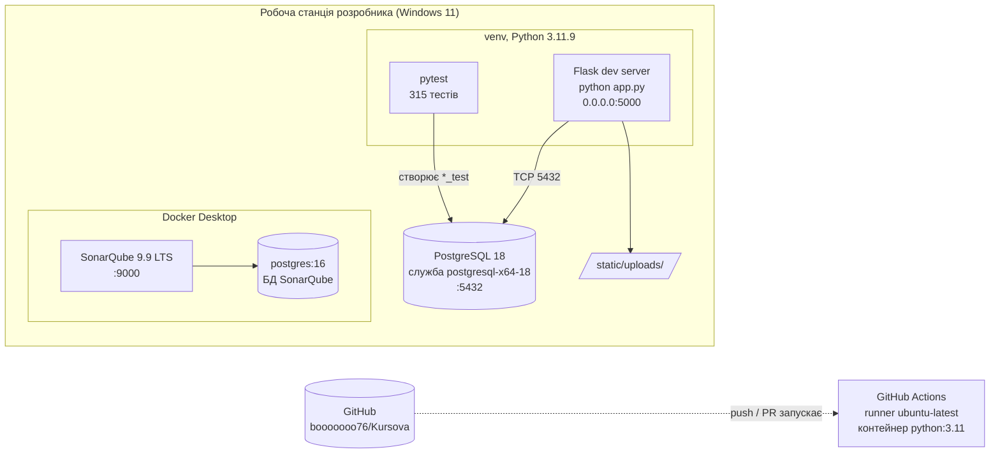
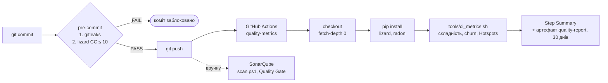

# ISD: де і на чому працює Kursova PC Shop

Документ відповідає на питання **«як підняти, налаштувати, перевірити й відновити систему»**. Внутрішню будову
описує [SDD](sdd.md), рішення — [ADR](adr/index.md).

## 1. Топологія розгортання



Топологія **локальна**: застосунок і БД працюють на одній машині, SonarQube у контейнерах Docker, хмарною є лише CI.
Production-середовища немає; вимоги до нього наведено в розділі 2, щоб розгортання не залежало від пам'яті автора.

## 2. Середовища

| | dev | test | demo | production (цільове) |
|---|---|---|---|---|
| Призначення | розробка | автотести | живий захист лаб | реальна робота магазину |
| Запуск | `python app.py` (debug, :5000) | `python -m pytest -q` | `python scripts/demo_db.py`, потім `$env:DB_NAME="computer_store_demo"; python app.py` | WSGI-сервер (waitress / gunicorn) за reverse proxy з HTTPS, без debug |
| БД | `computer_store` (з `.env`) | `<DB_NAME>_test`, pytest перестворює сам: `tests/db/schema_base.sql` + `migrations/` | `computer_store_demo`, лише синтетичні дані | окремий сервер PostgreSQL 18, окремий користувач з мінімальними правами |
| Дані | робочі | фабрики `tests/factories.py` | 3 вигадані користувачі | реальні, з резервними копіями |
| Хто відповідає | розробник | розробник / CI | розробник | DevOps |

### Змінні середовища (без секретів)

Шаблон: `.env.example` у корені репозиторію; файл `.env` у `.gitignore`. Секрети читає `config.py` лише з оточення: без
`SECRET_KEY` чи `DB_PASSWORD` застосунок не стартує.

| Змінна | Обов'язкова | За замовчуванням | Призначення |
|---|---|---|---|
| `SECRET_KEY` | так (секрет) | - | підпис сесійних cookie |
| `DB_PASSWORD` | так (секрет) | - | пароль PostgreSQL |
| `DB_HOST`, `DB_PORT` | ні | `localhost`, `5432` | адреса БД |
| `DB_NAME`, `DB_USER` | ні | `computer_store`, `postgres` | БД і користувач |
| `LOG_FORMAT`, `LOG_LEVEL` | ні | `text`, `INFO` | формат (`json` для збирачів) і рівень журналу |
| `CHAOS_DB_FAIL` | ні | вимкнено | Fault Injection: `error` або `timeout` (лише для експериментів Лаб.2) |
| `SONAR_TOKEN` | для `scan.ps1` | - | токен SonarQube, зберігається поза репозиторієм |

## 3. Компоненти розгортання

### <a id="web"></a>3.1. Вебзастосунок

- Довідка API працюючого екземпляра: `GET /api/docs` (Swagger UI), контракт `GET /api/openapi.yaml`.

- Python 3.11.9 у `venv`, залежності закріплені: `requirements.txt` (Flask 3.1.3, Flask-Login 0.6.3, psycopg2-binary
  2.9.10, Werkzeug 3.1.6), інструменти якості в `requirements-dev.txt`.
- Dev-запуск: `python app.py` (вбудований сервер Flask, `debug=True`, слухає 0.0.0.0:5000). Для production debug
  вимикається, сервер замінюється на WSGI.
- Готовність екземпляра: `GET /api/health` ([перевірка стану](sdd.md#c-health)).
- Описано в SDD: [маршрути](sdd.md#c-web), [оформлення замовлення](sdd.md#c-services), [приватність](sdd.md#c-privacy).

### <a id="db"></a>3.2. База даних

- PostgreSQL 18, служба Windows `postgresql-x64-18`, порт 5432.
- Схема: базовий дамп `tests/db/schema_base.sql` (оновлюється `scripts/dump_schema.ps1`) + ідемпотентні міграції
  `migrations/*.sql`, які застосовує `python scripts/migrate.py` (повторний запуск безпечний).
- Описано в SDD: [доступ до даних](sdd.md#c-dal), [модель даних](sdd.md#4-модель-даних).

### <a id="files"></a>3.3. Файлове сховище

`static/uploads/products/` і `static/uploads/news/`: зображення, які завантажують оператори
([операційні модулі](sdd.md#c-routers)). Каталог входить у резервне копіювання (розділ 7).

### <a id="logs"></a>3.4. Журнал подій

Пише в stderr ([безпечний журнал](sdd.md#c-log)). `LOG_FORMAT=json` дає по одному JSON-об'єкту на рядок для збирача
(Loki, ELK). Кожен запит має correlation ID; PII і секрети маскує санітайзер.

### <a id="sonar"></a>3.5. SonarQube

`sonarqube-server/docker-compose.yml` (поза репозиторієм застосунку): `sonarqube:lts-community` на :9000 і `postgres:16`
як його БД. Сканування: `$env:SONAR_TOKEN=...; .\scan.ps1` (контейнер `sonar-scanner-cli`, конфіг
`sonar-project.properties`). Quality Gate «Sonar way» (Лаб.1).

## 4. Порядок підняття

1. Запустити службу PostgreSQL (`Get-Service postgresql-x64-18`, статус Running).
2. Створити `.env` з `.env.example`, заповнити `SECRET_KEY` і `DB_PASSWORD`.
3. Застосувати міграції: `.\venv\Scripts\python.exe scripts\migrate.py`.
4. Запустити застосунок: `.\venv\Scripts\python.exe app.py`.
5. **Дочекатися готовності**: `Invoke-RestMethod http://localhost:5000/api/health` має повернути `status: ok`.
   503 `database: unavailable` → повернутися до кроку 1; 503 `migrations: missing` → крок 3 не виконано. Лише після
   `ok` екземпляр вважається готовим приймати користувачів.
6. Відкрити <http://localhost:5000> (якщо БД зникне під час роботи, `/products` покаже сторінку-заглушку замість 500).

Відкат релізу: `git checkout <попередній тег або коміт>`, перезапуск застосунку. Покроково: [порядок підняття](#4-порядок-підняття) у зворотному напрямку, перевірка — `GET /api/health`. Міграції лише додають об'єкти
(`IF NOT EXISTS`), тому старий код працює з новою схемою; руйнівні міграції заборонені регламентом.

## 5. <a id="ci"></a>CI/CD-конвеєр і Quality Gates



| Стадія | Тригер | Що перевіряє | Ворота (блокує?) |
|---|---|---|---|
| pre-commit, етап 1 | кожен `git commit` (`git config core.hooksPath .githooks`) | секрети в staged-змінах (gitleaks, `.gitleaks.toml`) | так |
| pre-commit, етап 2 | кожен коміт зі staged `*.py` | CC ≤ 10 для нових функцій (lizard), старий борг у `.complexity-baseline` | так |
| GitHub Actions `quality-metrics` | push, pull_request, вручну | складність, churn за 90 днів, матриця Hotspots | ні, інформує (артефакт) |
| GitHub Actions `docs` (публічний репозиторій `kursova-docs`) | push у main, pull_request, вручну | markdownlint, Spectral (0 errors), аудит `review_date`, `mkdocs build --strict`; деплой на GitHub Pages | так: будь-яке попередження = Exit Code 1, сайт не оновлюється |
| SonarQube | вручну, `scan.ps1` | баги, вразливості, code smells, дублікати | Quality Gate «Sonar way» |
| pytest | вручну перед злиттям | 315 тестів, потрібен PostgreSQL | за регламентом |

Документація має власний CD: Kursova приватний, тому `scripts/publish_docs.ps1` переносить у публічний репозиторій `booooooo76/kursova-docs` лише файли бази знань (зі збереженням історії комітів), а там `docs.yml` збирає й публікує сайт <https://booooooo76.github.io/kursova-docs/>. Код застосунку розгортається вручну за розділом 4. Прогалина: тести не запускаються в CI, бо потребують PostgreSQL. План:
додати в workflow service-контейнер `postgres:18`.

## 6. Експлуатаційні процедури

Покрокові інструкції для чергового — [runbook-и](../runbooks/RB-001.md); алерти, що їх запускають, —
[каталог алертів](../ops/alerts.md); цілі рівня послуг — [SLA / SLO / SLI](../ops/slo-policy.md).

### 6.1. Розгортання версії

```powershell
git fetch --tags; git checkout v1.1.0                      # тег релізу (Release Checklist, Лаб.12)
.\venv\Scripts\python.exe -m pip install -r requirements.txt
.\venv\Scripts\python.exe scripts\ops\backup_db.py          # копія перед зміною: точка відкату для даних
.\venv\Scripts\python.exe scripts\migrate.py               # ідемпотентні міграції
.\venv\Scripts\python.exe app.py
Invoke-RestMethod http://localhost:5000/api/health         # health-перевірка: status ok, інакше відкат
```

Екземпляр приймає трафік лише після `status: ok` (розділ 4). Відкат версії: `git checkout <попередній тег>`, перезапуск;
міграції лише додають об'єкти, тому попередній код працює з новою схемою.

### 6.2. Оновлення з міграціями

1. Прочитати розділ версії в [CHANGELOG](https://github.com/booooooo76/kursova-docs/blob/main/CHANGELOG.md)
   (`CHANGELOG.md` у корені): підрозділ «Змінено» називає нові міграції й зміни контракту API.
2. Перевірити міграцію на копії: `restore_drill.py` створює `<db>_restore_drill`, потім
   `$env:DB_NAME="<db>_restore_drill"; python scripts\migrate.py` (staging на знімку робочих даних).
3. Зробити копію робочої БД (`backup_db.py`), застосувати `migrate.py`, перезапустити застосунок, перевірити `/api/health`.
4. Руйнівні міграції (DROP, зміна типу з втратою) заборонені регламентом; якщо вона потрібна — окрема RFC з
   двофазним розгортанням (додати нове → перенести дані → прибрати старе в наступному релізі).

### 6.3. Відновлення після відмови: порядок підняття

Залежності: застосунок не працює без БД, БД — без служби PostgreSQL. Тому піднімати знизу вгору, перевіряючи кожен шар:

| Крок | Шар | Дія | Перевірка |
|---|---|---|---|
| 1 | ОС / служба | `Start-Service postgresql-x64-18` | `Get-Service postgresql-x64-18` = Running |
| 2 | Дані | БД ціла → далі; пошкоджена або втрачена → [RB-001](../runbooks/RB-001.md) | `restore_drill.py` = PASS |
| 3 | Схема | `python scripts\migrate.py` | без помилок |
| 4 | Застосунок | `python app.py` | `/api/health` = 200 `status: ok` |
| 5 | Користувачі | відкрити `/products`, вхід оператора | сторінки працюють |

### 6.4. Цільові RTO і RPO

**RTO = 60 хв** — допустимий час від відмови до відновлення роботи:

| Етап | Час | Звідки |
|---|---|---|
| виявлення | 3 хв | алерт A1: три перевірки поспіль |
| реакція чергового й діагностика (служба? БД? міграції?) | 15 хв | SEV-1, матриця ескалації |
| копія пошкодженого стану для розслідування | 2 хв | `backup_db.py`, 0,77 с на 11 МБ |
| відновлення й звірка | 5 хв | виміряно 0,93 с (локальна) / 2,14 с (з хмари) на 11 МБ; запас на ріст БД у 100 разів |
| міграції, запуск, перевірка за RB-001 | 10 хв | розділ 6.3 |
| резерв на ескалацію L2 → L3 | 25 хв | матриця ескалації: L3 підключається на 30-й хвилині |
| **Разом** | **60 хв** | |

**RPO = 24 год** — допустима втрата даних. Повна копія робиться раз на добу о 02:00, тож у найгіршому випадку (відмова
о 01:59) втрачаються замовлення за добу. Це прийнятно, бо кожне замовлення дублюється листом-підтвердженням клієнту
і оператор може внести його повторно; середнє навантаження — десятки замовлень на добу. Зменшити RPO до хвилин можна
безперервним архівуванням WAL (`archive_mode = on`, Point-in-Time Recovery); це наступний крок, коли БД вийде на
окремий сервер.

## 7. Політика резервного копіювання

| Параметр | Значення |
|---|---|
| Обсяг даних | робоча БД 11 МБ (`pg_database_size`), дамп `pg_dump -Fc` ≈ 0,2 МБ на демо-даних; `static/uploads/` |
| Тип і розклад | **повна** логічна копія `pg_dump -Fc` щодня о 02:00 (Планувальник завдань → `scripts\ops\backup_db.py`); перед кожним релізом — позапланова повна |
| Інкрементні копії | не потрібні: повна копія 11 МБ робиться за < 1 с; при рості БД > 10 ГБ — щотижнева повна `pg_basebackup` + інкрементні `pg_basebackup --incremental` (PostgreSQL 17+) щодня |
| Строк зберігання (retention) | 7 щоденних, 4 тижневі (неділя), 3 місячні (1-ше число); старіші видаляє той самий скрипт |
| Цілісність | SHA-256 кожної копії в маніфесті JSON поруч із дампом; перевіряється перед відновленням |
| Шифрування | копія поза майданчиком — AES-256-CBC, PBKDF2 200 000 ітерацій (openssl); ключ `%USERPROFILE%\.kursova_backup_pass` поза репозиторієм, другий примірник ключа — у менеджері паролів власника |
| Файли | `static/uploads/` копіюється в той самий каталог щодня (robocopy /MIR) |

### Правило 3-2-1

| Копія | Де | Носій | Майданчик |
|---|---|---|---|
| 1 | робоча БД, каталог даних PostgreSQL на диску C: | локальний SSD | основний |
| 2 | `D:\Backups\kursova\*.dump` + маніфест | **інший фізичний диск** | основний |
| 3 | `OneDrive\KursovaBackups\*.dump.enc`, зашифрована | **хмарне сховище** | **поза майданчиком** |

3 копії, 2 типи носіїв (локальний диск і хмара), 1 поза майданчиком. Без ключа шифрування скрипт попереджає, що
копію 3 не створено і правило 3-2-1 не виконано.

### Restore drill (тестове відновлення)

Резервна копія, відновлення з якої ніколи не перевірялося, копією не вважається. Тому:

- **Коли:** раз на місяць (алерт A3, якщо минуло > 35 днів) і після кожної зміни скрипта копіювання.
- **Як:** `.\venv\Scripts\python.exe scripts\ops\restore_drill.py --db computer_store` (і раз на квартал з
  `--from-offsite`): відновлення в окрему БД `<db>_restore_drill`, звірка SHA-256, кількості рядків у кожній таблиці
  й таблиць міграцій; робоча БД не зачіпається.
- **Критерій PASS:** контрольна сума збіглася, 0 розбіжностей рядків, усі таблиці міграцій на місці, час ≤ 5 хв.
- **Протокол:** `docs/ops/data/restore_drill_<UTC>.json`, підсумок — в історії перевірок [RB-001](../runbooks/RB-001.md).

Останні перевірки 2026-11-27 (демо-БД, 45 таблиць): з локальної копії — PASS за 0,93 с; із зашифрованої копії 3 —
PASS за 2,14 с.

## 8. Моніторинг

| Що | Як | Ціль |
|---|---|---|
| Доступність | `tools/ops_check.py` щохвилини: `GET /api/health` (алерт A1) | SLI-1 ≥ 99,5 % |
| Латентність | k6 `loadtest/products_slo.js` (Лаб.2) | SLI-2: p95 < 300 мс у ≥ 99 % хвилин |
| Резервні копії | свіжість маніфесту (A2), давність restore drill (A3) | RPO 24 год, drill ≤ 35 днів |
| Бюджет помилок | `tools/error_budget.py` щодня (A4) | політика FREEZE |
| Помилки | журнал stderr (`LOG_FORMAT=json` у файл для збирача), `security_event` | реакція за матрицею ескалації |

## 9. Пов'язані документи

[головна](../index.md) · [SDD](sdd.md) · [ADR](adr/index.md) · [регламент](maintenance.md) ·
[запобігання секретам](../lab3/secrets_prevention.md) · [pre-commit](../lab6/precommit.md)

## Пов'язані у базі знань

[[sdd]] · [[local-setup]] · [[maintenance]] · [[handover]] · [[secrets_prevention]] · [[precommit]] · [[RB-001]] · [[alerts]] · [[slo-policy]] #ops
