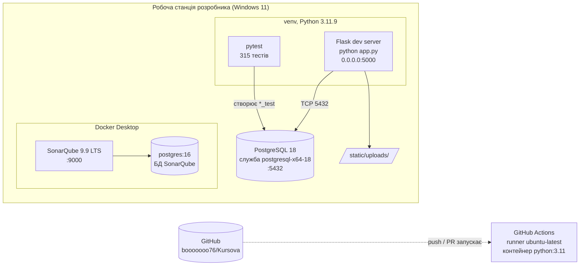

# ISD: де і на чому працює Kursova PC Shop

Документ відповідає на питання **«як підняти, налаштувати, перевірити й відновити систему»**. Внутрішню будову
описує [SDD](sdd.md), рішення — [ADR](adr/index.md).

## 1. Топологія розгортання

Топологія **локальна**: застосунок і БД працюють на одній машині, SonarQube у контейнерах Docker, хмарною є лише CI.
Production-середовища немає; вимоги до нього наведено в розділі 2, щоб розгортання не залежало від пам'яті автора.

## 2. Середовища

| | dev | test | demo | production (цільове) |
|---|---|---|---|---|
| Призначення | розробка | автотести | живий захист лаб | реальна робота магазину |
| Запуск | `python app.py` (debug, :5000) | `python -m pytest -q` | `python scripts/demo_db.py`, потім `$env:DB_NAME="computer_store_demo"; python app.py` | WSGI-сервер (waitress / gunicorn) за reverse proxy з HTTPS, без debug |
| БД | `computer_store` (з `.env`) | `<DB_NAME>_test`, pytest перестворює сам: `tests/db/schema_base.sql` + `migrations/` | `computer_store_demo`, лише синтетичні дані | окремий сервер PostgreSQL 18, окремий користувач з мінімальними правами |
| Дані | робочі | фабрики `tests/factories.py` | 3 вигадані користувачі | реальні, з резервними копіями |
| Хто відповідає | розробник | розробник / CI | розробник | DevOps |

### Змінні середовища (без секретів)

Шаблон: `.env.example` у корені репозиторію; файл `.env` у `.gitignore`. Секрети читає `config.py` лише з оточення: без
`SECRET_KEY` чи `DB_PASSWORD` застосунок не стартує.

| Змінна | Обов'язкова | За замовчуванням | Призначення |
|---|---|---|---|
| `SECRET_KEY` | так (секрет) | - | підпис сесійних cookie |
| `DB_PASSWORD` | так (секрет) | - | пароль PostgreSQL |
| `DB_HOST`, `DB_PORT` | ні | `localhost`, `5432` | адреса БД |
| `DB_NAME`, `DB_USER` | ні | `computer_store`, `postgres` | БД і користувач |
| `LOG_FORMAT`, `LOG_LEVEL` | ні | `text`, `INFO` | формат (`json` для збирачів) і рівень журналу |
| `CHAOS_DB_FAIL` | ні | вимкнено | Fault Injection: `error` або `timeout` (лише для експериментів Лаб.2) |
| `SONAR_TOKEN` | для `scan.ps1` | - | токен SonarQube, зберігається поза репозиторієм |

## 3. Компоненти розгортання

### 3.1. Вебзастосунок

- Довідка API працюючого екземпляра: `GET /api/docs` (Swagger UI), контракт `GET /api/openapi.yaml`.

- Python 3.11.9 у `venv`, залежності закріплені: `requirements.txt` (Flask 3.1.3, Flask-Login 0.6.3, psycopg2-binary
  2.9.10, Werkzeug 3.1.6), інструменти якості в `requirements-dev.txt`.
- Dev-запуск: `python app.py` (вбудований сервер Flask, `debug=True`, слухає 0.0.0.0:5000). Для production debug
  вимикається, сервер замінюється на WSGI.
- Готовність екземпляра: `GET /api/health` ([перевірка стану](sdd.md#c-health)).
- Описано в SDD: [маршрути](sdd.md#c-web), [оформлення замовлення](sdd.md#c-services), [приватність](sdd.md#c-privacy).

### 3.2. База даних

- PostgreSQL 18, служба Windows `postgresql-x64-18`, порт 5432.
- Схема: базовий дамп `tests/db/schema_base.sql` (оновлюється `scripts/dump_schema.ps1`) + ідемпотентні міграції
  `migrations/*.sql`, які застосовує `python scripts/migrate.py` (повторний запуск безпечний).
- Описано в SDD: [доступ до даних](sdd.md#c-dal), [модель даних](sdd.md#4-модель-даних).

### 3.3. Файлове сховище

`static/uploads/products/` і `static/uploads/news/`: зображення, які завантажують оператори
([операційні модулі](sdd.md#c-routers)). Каталог входить у резервне копіювання (розділ 6).

### 3.4. Журнал подій

Пише в stderr ([безпечний журнал](sdd.md#c-log)). `LOG_FORMAT=json` дає по одному JSON-об'єкту на рядок для збирача
(Loki, ELK). Кожен запит має correlation ID; PII і секрети маскує санітайзер.

### 3.5. SonarQube

`sonarqube-server/docker-compose.yml` (поза репозиторієм застосунку): `sonarqube:lts-community` на :9000 і `postgres:16`
як його БД. Сканування: `$env:SONAR_TOKEN=...; .\scan.ps1` (контейнер `sonar-scanner-cli`, конфіг
`sonar-project.properties`). Quality Gate «Sonar way» (Лаб.1).

## 4. Порядок підняття

1. Запустити службу PostgreSQL (`Get-Service postgresql-x64-18`, статус Running).
2. Створити `.env` з `.env.example`, заповнити `SECRET_KEY` і `DB_PASSWORD`.
3. Застосувати міграції: `.\venv\Scripts\python.exe scripts\migrate.py`.
4. Запустити застосунок: `.\venv\Scripts\python.exe app.py`.
5. **Дочекатися готовності**: `Invoke-RestMethod http://localhost:5000/api/health` має повернути `status: ok`.
   503 `database: unavailable` → повернутися до кроку 1; 503 `migrations: missing` → крок 3 не виконано. Лише після
   `ok` екземпляр вважається готовим приймати користувачів.
6. Відкрити <http://localhost:5000> (якщо БД зникне під час роботи, `/products` покаже сторінку-заглушку замість 500).

Відкат релізу: `git checkout <попередній тег або коміт>`, перезапуск застосунку. Покроково: [порядок підняття](#4-порядок-підняття) у зворотному напрямку, перевірка — `GET /api/health`. Міграції лише додають об'єкти
(`IF NOT EXISTS`), тому старий код працює з новою схемою; руйнівні міграції заборонені регламентом.

## 5. CI/CD-конвеєр і Quality Gates

| Стадія | Тригер | Що перевіряє | Ворота (блокує?) |
|---|---|---|---|
| pre-commit, етап 1 | кожен `git commit` (`git config core.hooksPath .githooks`) | секрети в staged-змінах (gitleaks, `.gitleaks.toml`) | так |
| pre-commit, етап 2 | кожен коміт зі staged `*.py` | CC ≤ 10 для нових функцій (lizard), старий борг у `.complexity-baseline` | так |
| GitHub Actions `quality-metrics` | push, pull_request, вручну | складність, churn за 90 днів, матриця Hotspots | ні, інформує (артефакт) |
| GitHub Actions `docs` (публічний репозиторій `kursova-docs`) | push у main, pull_request, вручну | markdownlint, Spectral (0 errors), аудит `review_date`, `mkdocs build --strict`; деплой на GitHub Pages | так: будь-яке попередження = Exit Code 1, сайт не оновлюється |
| SonarQube | вручну, `scan.ps1` | баги, вразливості, code smells, дублікати | Quality Gate «Sonar way» |
| pytest | вручну перед злиттям | 315 тестів, потрібен PostgreSQL | за регламентом |

Документація має власний CD: Kursova приватний, тому `scripts/publish_docs.ps1` переносить у публічний репозиторій `booooooo76/kursova-docs` лише файли бази знань (зі збереженням історії комітів), а там `docs.yml` збирає й публікує сайт <https://booooooo76.github.io/kursova-docs/>. Код застосунку розгортається вручну за розділом 4. Прогалина: тести не запускаються в CI, бо потребують PostgreSQL. План:
додати в workflow service-контейнер `postgres:18`.

## 6. Моніторинг і резервне копіювання

| Що | Як | Ціль |
|---|---|---|
| Доступність | `GET /api/health` щохвилини (200 = готовий, 503 = БД або міграції); SLO-перевірка навантаженням k6 (`loadtest/*.js`, Лаб.2) | SLO: p95 ≤ 300 мс, помилки < 1 % (`http_req_failed rate<0.01`) |
| Помилки | журнал stderr (`LOG_LEVEL=WARNING` і вище), `security_event` для подій безпеки | реакція в робочий день |
| Резервна копія БД | `pg_dump -Fc -h localhost -U postgres computer_store -f backup_YYYYMMDD.dump`, щодня; зберігати 7 останніх поза робочим диском | **RPO = 24 год** (втрата не більше одного дня замовлень) |
| Резервна копія файлів | копія `static/uploads/` разом із дампом | RPO = 24 год |
| Відновлення | `createdb computer_store_restore`, `pg_restore -d computer_store_restore backup.dump`, `python scripts/migrate.py`, змінити `DB_NAME`, перезапустити застосунок | **RTO = 1 год** |
| Перевірка копій | раз на місяць відновити дамп у `computer_store_restore` і прогнати `pytest` на схемі | копія, яку не відновлювали, не вважається копією |

## 7. Пов'язані документи

[головна](../index.md) · [SDD](sdd.md) · [ADR](adr/index.md) · [регламент](maintenance.md) ·
[запобігання секретам](../lab3/secrets_prevention.md) · [pre-commit](../lab6/precommit.md)

## Пов'язані у базі знань

[[sdd]] · [[local-setup]] · [[maintenance]] · [[handover]] · [[secrets_prevention]] · [[precommit]] #ops
