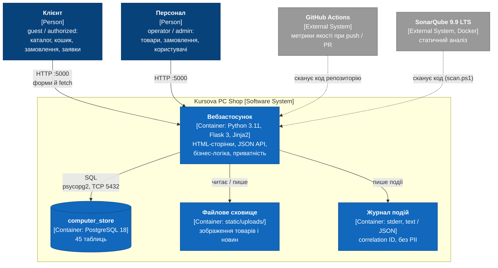
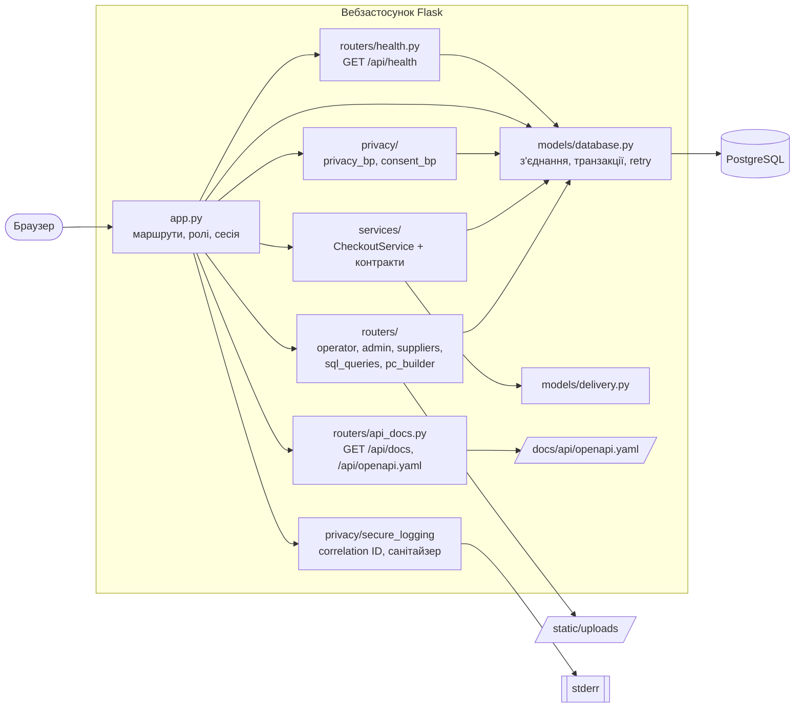
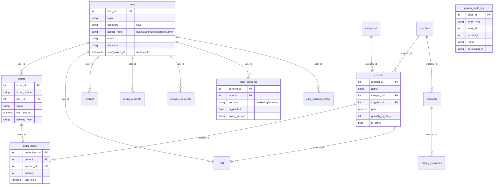

# SDD: як влаштована система Kursova PC Shop

Документ відповідає на питання **«з чого складається система і як частини взаємодіють»**. Де і на чому вона працює,
описує [ISD](isd.md), чому прийнято саме такі рішення — [ADR](adr/index.md). Швидкий старт є на [головній сторінці](../index.md).

## 1. Призначення й межі

Kursova PC Shop — вебзастосунок комп'ютерного магазину із сервісним центром:

- **каталог і продаж**: товари, кошик, обране, оформлення замовлення, конфігуратор ПК;
- **сервіс**: заявки на ремонт техніки й встановлення ПЗ з історією статусів;
- **операційна робота**: товари, замовлення, новини, постачальники, контракти й поставки;
- **адміністрування**: користувачі, заявки на права доступу, статистика, SQL-консоль і бібліотека запитів;
- **приватність (Лаб.4)**: експорт персональних даних, анонімізація, згоди, аудит.

| Роль (`keys.access_right`) | Що може |
|---|---|
| guest (без входу) | каталог, новини, кошик у сесії |
| authorized | замовлення, обране, заявки, профіль, власні персональні дані й згоди |
| operator | товари, замовлення, заявки, новини, постачальники, продажі |
| admin | усе вище + користувачі, SQL-консоль, анонімізація будь-кого |

## 2. C4: діаграма контейнерів

Нотація C4 (Person, Container, Database, External System) у синтаксисі Mermaid flowchart: так діаграма однаково
читається на GitHub, в Obsidian і в PNG-звіті.

Кожен контейнер розгорнуто так, як описано в ISD: [вебзастосунок](isd.md#web), [БД](isd.md#db),
[файли](isd.md#files), [журнал](isd.md#logs), [CI](isd.md#ci), [SonarQube](isd.md#sonar).

## 3. Компоненти вебзастосунку (C4, рівень 3)

| Компонент | Відповідальність | Ключові файли | Залежить від | Розгортання |
|---|---|---|---|---|
| **Маршрути й сесія** | точка входу Flask: 34 власні маршрути (каталог, кошик, обране, замовлення, профіль, заявки, новини), реєстрація 64 маршрутів з `routers/` через `add_url_rule`, 2 blueprint-и приватності; авторизація Flask-Login і декоратор `require_permission(role)` | `app.py`, `config.py`, `templates/`, `static/js/` | [Операційні модулі](#c-routers), [Оформлення замовлення](#c-services), [Приватність](#c-privacy), [Перевірка стану](#c-health), [Доступ до даних](#c-dal), [Журнал](#c-log) | [ISD: вебзастосунок](isd.md#web) |
| **Операційні модулі** | `operator.py` товари, зображення, замовлення, заявки, новини; `admin.py` користувачі, заявки на права, статистика; `suppliers.py` постачальники, контракти, зобов'язання, поставки; `sql_queries.py` SQL-консоль, бібліотека й історія запитів; `pc_builder.py` конфігуратор ПК | `routers/*.py` | [Доступ до даних](#c-dal), файлове сховище | [ISD: файли](isd.md#files) |
| **Оформлення замовлення** | сценарій checkout після декомпозиції God Object (Лаб.8): кошик, каталог, ціни й доставка, термін доставки, запис замовлення в одній транзакції; залежить лише від Protocol-контрактів, реалізації підставляє Composition Root | `services/contracts.py`, `checkout.py`, `cart.py`, `pricing.py`, `delivery_estimate.py`, `orders.py`, `composition.py`, `values.py`, `promotions.py` | [Доступ до даних](#c-dal), `models/delivery.py` | [ISD: вебзастосунок](isd.md#web) |
| **Приватність** | REST API експорту даних суб'єкта й анонімізації (право на забуття), згоди за цілями з історією, черга маркетингу (outbox), аналітика лише за згодою, аудит без PII; правила в `consent.py`, політики в `policy.py` (Лаб.4, 7) | `privacy/api.py`, `consent_api.py`, `consent.py`, `erasure.py`, `export.py`, `actions.py`, `policy.py` | [Доступ до даних](#c-dal), [Журнал](#c-log) | [ISD: вебзастосунок](isd.md#web) |
| **Доступ до даних** | з'єднання psycopg2 (`get_db_connection`), `execute_query`, `transaction()` (Лаб.7), `execute_query_resilient` з обмеженими повторами й експоненційною паузою (Лаб.2), перевірка пароля за хешем | `models/database.py` | PostgreSQL | [ISD: БД](isd.md#db) |
| **Довідка API** | `GET /api/openapi.yaml` віддає контракт `docs/api/openapi.yaml` без змін (Single Source of Truth), `GET /api/docs` — Swagger UI на тому самому домені для «Try it out» | `routers/api_docs.py`, `docs/api/openapi.yaml` | файл контракту | [ISD: вебзастосунок](isd.md#web) |
| **Перевірка стану** | `GET /api/health`: перевіряє з'єднання з БД (`SELECT 1`) і наявність таблиць міграцій (`privacy_audit_log`, `user_consents`, `user_consent_history`, `marketing_outbox`); 200 `ok` або 503 `degraded` без деталей помилок і PII; використовується скриптом розгортання й моніторингом | `routers/health.py` | [Доступ до даних](#c-dal) | [ISD: порядок підняття](isd.md#4-порядок-підняття), [моніторинг](isd.md#6-моніторинг-і-резервне-копіювання) |
| **Безпечний журнал** | формат text або JSON (`LOG_FORMAT`), correlation ID на кожен запит, санітайзер PII і секретів, `security_event` для подій безпеки (Лаб.4) | `privacy/secure_logging.py`, `privacy/sanitizer.py` | stderr | [ISD: журнал](isd.md#logs) |

## 4. Модель даних

Джерело правди: `tests/db/schema_base.sql` (`pg_dump --schema-only`) + `migrations/001_privacy_core.sql`,
`002_consent.sql`. Старий документ схеми перенесено в [архів](../archive/README.md) як застарілий.

| Домен | Таблиці (45) |
|---|---|
| користувачі й доступ | keys, registration_requests, user_activity_log |
| каталог | products, categories, product_attributes, product_images, product_reviews, promotions, promotion_products, delivery_methods, payment_methods |
| продаж | cart, wishlist, orders, order_items, sales, sale_items, returns, return_items, warranties |
| сервіс | repair_requests, repair_status_history, software_requests, software_status_history, repairs, repair_parts, service_types, service_orders |
| конфігуратор | computer_configurations, config_components |
| постачання | suppliers, contracts, contract_obligations, supply_deliveries, delivery_items |
| контент і SQL | news, saved_queries, query_results, sql_execution_log |
| приватність (міграції) | privacy_audit_log, user_consents, user_consent_history, marketing_outbox, analytics_events |

## 5. API-контракти між компонентами

### 5.1. Браузер ↔ вебзастосунок

| Група | Маршрути | Формат | Роль |
|---|---|---|---|
| Каталог | `GET /`, `/products`, `/products/<id>`, `/news`, `/news/<id>`, `/about`, `/repairs`, `/software` | HTML | guest |
| Кошик і обране | `GET /cart`, `POST /add-to-cart`, `/update-cart`, `/remove-from-cart/<id>`; `GET /wishlist`, `POST /add-to-wishlist`; `GET /api/cart/count`, `/api/wishlist/count` | HTML, JSON `{count}` | guest / authorized |
| Замовлення | `GET /checkout`, `POST /create-order`, `GET /order-success/<id>`, `/my-orders/<id>` | HTML | authorized |
| Обліковий запис | `/register`, `/login`, `/logout`, `/profile`, `POST /profile/update`, `/profile/change-password`, `/request-authorization` | HTML | guest / authorized |
| Заявки | `POST /submit-repair-request`, `/submit-software-request`, `GET /my-requests` | HTML | authorized |
| Оператор | `/operator/dashboard`, `/operator/orders[/<id>]`, `POST /api/orders/update-status`, `/api/orders/cancel`, `GET /api/orders/export`, `/operator/products/add`, `/api/products/<id>/delete`, `/upload-image`, `/operator/repair/<id>`, `/operator/software/<id>`, `/operator/news...`, `/sales` | HTML, JSON | operator |
| Постачання | `/suppliers...`, `/contracts...`, `/deliveries...` (CRUD, приймання поставки) | HTML | operator |
| Адміністратор | `/admin`, `/admin/users...`, `/admin/stats/employees`, `/sql-console`, `/sql-query`, `/queries`, `POST /api/queries/<id>/execute` | HTML, JSON | admin |
| Конфігуратор | `GET /pc-builder`, `POST /pc-builder/save`, `/pc-configs[/<id>]`, `POST /pc-configs/<id>/confirm` | HTML | authorized |

### 5.2. REST API приватності (JSON)

| Метод і шлях | Що робить | Доступ | Відповідь |
|---|---|---|---|
| `GET /api/users/<id>/personal-data` | експорт усіх персональних даних суб'єкта | сам користувач або admin | 200 JSON; 401; 403; 404; 503 БД недоступна |
| `POST /api/users/<id>/anonymize` `{"confirm": "ANONYMIZE"}` | анонімізація (право на забуття) в одній транзакції; ідемпотентна | сам або admin | 200 `anonymized` / `already_anonymized`; 400 без підтвердження; 404; 500 (відкочено) |
| `GET /api/users/<id>/consents` | стан згод за цілями | сам або admin | 200 JSON; 404 |
| `POST /api/users/<id>/consents/<purpose>/grant` `{policy_version, source}` | дати згоду | лише сам | 200; 400; 409 версія політики або суб'єкт анонімізований |
| `POST /api/users/<id>/consents/<purpose>/revoke` | відкликати згоду | сам або admin | 200; 404; 409 |
| `POST /api/users/<id>/marketing/send` | поставити лист у marketing_outbox (лише зі згодою) | admin | 202 `queued`; 403 немає згоди |
| `POST /api/marketing/process-queue` | обробити чергу з повторною перевіркою згоди | admin | 200 `{sent, cancelled}` |
| `POST /api/users/<id>/analytics/events` `{event_name}` | записати подію аналітики лише за згодою | лише сам | 200; 403 немає згоди |

Усі дії пишуться в `privacy_audit_log` (тип, хто, над ким, результат, correlation ID) без самих персональних даних.

### 5.3. Повний перелік JSON-ендпоінтів

Регламент ([maintenance.md](maintenance.md)) вимагає, щоб тут був **кожен** маршрут `/api/...` з коду: ворота
`tools/doc_currency.py` звіряють цей перелік із кодом автоматично. Ендпоінти приватності описано в 5.2.

| Метод і шлях | Що робить | Доступ |
|---|---|---|
| `GET /api/docs` | Swagger UI працюючого екземпляра | без автентифікації |
| `GET /api/openapi.yaml` | контракт OpenAPI (той самий файл, що й на сайті документації) | без автентифікації |
| `GET /api/health` | стан екземпляра: БД і міграції; 200 `{"status": "ok", "checks": {...}}` або 503 `degraded` (+ `missing_tables`) | без автентифікації (моніторинг) |
| `GET /api/cart/count` | кількість позицій у кошику (сесія або БД) | guest / authorized |
| `GET /api/wishlist/count` | кількість товарів в обраному | authorized |
| `POST /api/products/<id>/delete` | приховати товар (м'яке видалення) | operator |
| `POST /api/products/<id>/delete-permanently` | видалити товар остаточно | operator |
| `POST /api/products/<id>/restore` | відновити прихований товар | operator |
| `POST /api/products/<id>/upload-image` | завантажити зображення товару в `static/uploads/products/` | operator |
| `POST /api/products/images/<id>/delete` | видалити зображення | operator |
| `POST /api/products/images/<id>/set-main` | зробити зображення головним | operator |
| `POST /api/orders/update-status` | змінити статус замовлення | operator |
| `POST /api/orders/cancel` | скасувати замовлення | operator |
| `GET /api/orders/export` | вивантажити замовлення | operator |
| `POST /api/queries/<id>/execute` | виконати збережений SQL-запит | admin |
| `POST /api/queries/<id>/delete` | видалити збережений запит | admin |
| `POST /api/queries/export` | вивантажити результат запиту | admin |

Формальний контракт чотирьох маршрутів (схеми, приклади, коди відповідей) — `docs/api/openapi.yaml`, версія 1.0.1; відповідність живому коду перевіряють `tests/test_api_contract.py` і Schemathesis (`tools/contract_test.py`). Помилки всіх JSON-маршрутів, включно з 404 і 500 для `/api/...`, повертаються єдиним об'єктом `{"error": "<код>"}`; HTML-сторінку помилки отримують лише звичайні сторінки.

### 5.4. Внутрішні контракти

| Контракт | Хто викликає | Реалізація |
|---|---|---|
| `CartStore`, `Catalog`, `PricingPolicy`, `DeliveryEstimator`, `OrderRepository` (`services/contracts.py`, `typing.Protocol`) | `CheckoutService`, `CartSummary` | `SessionCart` / `DbCart`, `ProductCatalog`, `DeliveryPricing`, `DeliveryWindowEstimator`, `SqlOrderRepository`; збирає `services/composition.py` |
| `execute_query(sql, params, fetch)`, `transaction()` | усі компоненти | `models/database.py`; параметризовані запити psycopg2 |
| `execute_query_resilient(..., max_retries=3, base_delay=0.2)` | каталог `/products` | повтори лише на `OperationalError`, далі `DependencyUnavailableError` → сторінка-заглушка замість 500 |
| `security_event(name, **fields)` | вхід, зміна пароля, приватність | `privacy/secure_logging.py` |

## 6. Наскрізні механізми

- **Автентифікація**: Flask-Login, сесія в підписаному cookie (`SECRET_KEY` обов'язковий, без нього застосунок не
  стартує), паролі як хеш werkzeug; ролі перевіряє `require_permission`.
- **Стійкість**: обмежені повтори з'єднання з БД, Fault Injection через `CHAOS_DB_FAIL` (Лаб.2).
- **Якість**: pre-commit (gitleaks + lizard CC ≤ 10), GitHub Actions (Hotspots), SonarQube; 315 тестів pytest.
- **Приватність**: мінімізація логів, згоди за цілями, право на забуття (Лаб.4, ADR-0002).

## 7. Пов'язані документи

[головна](../index.md) · [ISD](isd.md) · [ADR-0001 PostgreSQL](adr/0001-postgresql-psycopg2.md) ·
[ADR-0002 приватність](adr/0002-privacy-by-design-module.md) · [регламент](maintenance.md) ·
політики приватності [docs/lab4/](../lab4/consent.md) · [архів](../archive/README.md)

## Пов'язані у базі знань

[[isd]] · [[0001-postgresql-psycopg2]] · [[0002-privacy-by-design-module]] · [[maintenance]] · [[openapi-contract]] · [[consent]] #architecture
