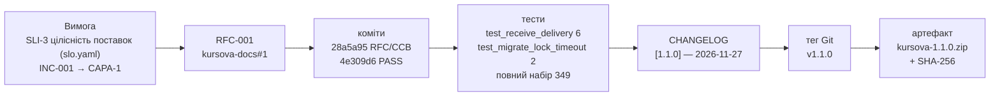

# Release Checklist v1.1.0 (go / no-go)

Реліз за [RFC-001](RFC-001.md), рішення [CCB-2026-11-27](CCB-2026-11-27.md) «погоджено з умовами». Перевірку виконано
2026-11-27 о 20:34–20:36 UTC, у вікні розгортання 21:00–21:30 UTC.

## 1. Критерії go / no-go

| № | Критерій | Доказ | Стан |
|---|---|---|---|
| 1 | Тести зелені: регресійні й повний набір | `tests/test_receive_delivery.py` 6/6 + `test_migrate_lock_timeout.py` 2/2 (`pytest_pass.txt`); повний pytest **349 passed** (`pytest_full_pass.txt`) | GO |
| 2 | Сценарій інциденту більше не відтворюється | `incident_sim.py` lock: надлишок 0; fault: склад без змін, A5 FIRING | GO |
| 3 | Міграції перевірено на staging | staging = відновлена з копії БД `computer_store_demo_restore_drill` (restore drill PASS, 27,83 с); `migrate.py` з `lock_timeout` застосував 001 і 002 без помилок | GO |
| 4 | Документація й CHANGELOG (DoD Лаб.11) | `CHANGELOG.md` [1.1.0]; ADR-0003, RB-002, A5, legacy-документ, план супроводу; `mkdocs build --strict` без попереджень, markdownlint 0, `doc_review_dates.py` PASS | GO |
| 5 | Моніторинг і алерти | A5 DeliveryReceiveFailed у `ops_check.py` і [каталозі](../ops/alerts.md); перевірено FIRING на збій | GO |
| 6 | Runbook відкату під рукою | [RFC-001 §4](RFC-001.md#4-план-відкату): `git checkout v1.0.0`; тег `v1.0.0` існує; схема не змінювалась | GO |
| 7 | Резервна копія перед розгортанням | `computer_store_demo_20261127T203432Z_daily.dump`, SHA-256 `0660b689…9615706`, копія 3 у OneDrive | GO |
| 8 | Бюджет помилок не в FREEZE | `error_budget.py`: SLI-1 0 %, SLI-2 0 %, SLI-3 7,2 % — NORMAL | GO |
| 9 | Комунікація підготовлена | повідомлення операторам (розділ 3) | GO |

**Рішення: GO** (9/9). No-go, якщо не виконано хоча б 1, 2, 3, 6 або 7: тоді RFC повертається в Assessment.

## 2. Ланцюг простежуваності релізу

| Ланка | Ідентифікатор | Де перевірити |
|---|---|---|
| Вимога | SLI-3 `supply-receipt-integrity` (SLO 99,9 %); CAPA-1 з [Post-Mortem INC-001](../incidents/postmortem-INC-001.md) | `docs/slo.yaml`, [CAPA](../incidents/capa-INC-001.md) |
| RFC | RFC-001, [kursova-docs#1](https://github.com/booooooo76/kursova-docs/issues/1) | мітки `state:*`, коментарі переходів |
| Коміти | `28a5a95` (RFC, CCB), `4e309d6` (реалізація CAPA, PASS); FAIL до зміни — `e90ab0e` | `git log v1.0.0..v1.1.0` |
| Тести | `tests/test_receive_delivery.py`, `tests/test_migrate_lock_timeout.py` | `python -m pytest -q tests/test_receive_delivery.py` |
| CHANGELOG | розділ `[1.1.0] — 2026-11-27` | `CHANGELOG.md` |
| Тег | `v1.1.0` (анотований; базова версія для відкату — `v1.0.0`) | `git show v1.1.0` |
| Артефакт | `kursova-1.1.0.zip` = `git archive v1.1.0`; SHA-256 — в анотації тегу й у коментарі закриття RFC | `Get-FileHash kursova-1.1.0.zip -Algorithm SHA256` |

## 3. Комунікація

Операторам (чат `#kursova-ops`, 2026-11-27): «Сьогодні о 23:00–23:30 за Києвом оновлення 1.1.0. Повторне натискання
"Прийняти поставку" більше не змінює склад; якщо бачите "Не вдалося прийняти поставку через збій бази даних" —
залишки не змінено, спробуйте пізніше. Під час оновлення не приймайте поставки.»

## 4. Після розгортання

| Перевірка | Результат |
|---|---|
| `/api/health` | 200 `ok` |
| `ops_check.py` | A1–A3 OK; A5 OK після вікна 15 хв без нових подій |
| RFC-001 | Implemented → Closed; CAPA-1…3 → Implemented (спостереження ефективності триває) |

## Пов'язані у базі знань

[[RFC-001]] · [[CCB-2026-11-27]] · [[ccb-regulation]] · [[capa-INC-001]] #change
