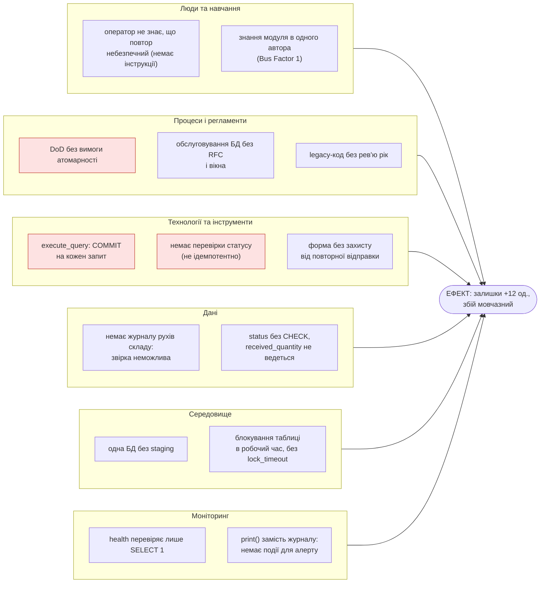

# Post-Mortem INC-001: подвійне приймання поставки

**Беззвинуватний формат.** Аналізуємо системи й процеси, а не людей. Друге натискання оператора — нормальна реакція на
сторінку, що «висить» 15 секунд. Обслуговування БД у робочий час — наслідок того, що жодне правило його не забороняло.
Покарання за чесний звіт гарантує, що наступний звіт буде брехливим.

Факти й хронологія — [Incident Report](INC-001.md). Підсумок: одна поставка додала до складу +12 зайвих одиниць,
жодна система цього не помітила.

## 1. Що пішло добре

- Застосунок лишався доступним; моніторинг доступності й журнал працювали як задумано.
- Обхід зайняв 2,5 хв: дані виправлено однією транзакцією з умовою, без відновлення БД з копії.
- Свіжа резервна копія й перевірений RB-001 були під рукою (не знадобились).

## 2. Ланцюжок «5 Чому»

| Рівень | Питання | Відповідь | Доказ |
|---|---|---|---|
| Симптом | Що сталося? | Залишки трьох товарів більші за фактичні на кількість у поставці (+4, +2, +6) | `INC-001_simulation_fail.json`, `reconciliation`: `excess` = `in_delivery` для кожного товару |
| 1 | Чому залишки завищені? | `receive_delivery()` застосувала одну поставку двічі | `INC-001_app_fail.log` рядки 9–10: два `POST /deliveries/1/receive` → 302 |
| 2 | Чому одну поставку можна застосувати двічі? | Обробник не перевіряє статус поставки перед зміною залишків: повторний POST для вже прийнятої (або ще не завершеної) поставки знову додає кількість | `routers/suppliers.py:663-692`: SELECT позицій і UPDATE products без умови `status = 'expected'`; тест `test_repeated_receive_does_not_add_stock_again` червоний (`pytest_fail.txt`) |
| 3 | Чому перший запит не завершився і з'явився другий? | Кожен `execute_query` — окреме з'єднання з власним COMMIT. Залишки закомічено одразу, а оновлення статусу чекало на заблоковану таблицю 38 с; сторінка «висіла» | `models/database.py:53-70` (COMMIT у кожному виклику); `operator_response`: `waited_s` 38,0 і 23,0 |
| 4 | Чому таблицю поставок заблоковано на 40 с у робочий час? | Обслуговування схеми виконувалось на живій БД поза вікном обслуговування і без `lock_timeout`; регламенту, який вимагав би для цього RFC і вікно, не було | `maintenance_lock_acquired` 20:16:06, `hold_s` 40; `grep lock_timeout scripts models` — 0 збігів; ISD і регламент до Лаб.12 не містять вікна обслуговування |
| 5 | Чому неатомарна й неідемпотентна операція зі складом прожила рік непоміченою? | Процес розробки не має критерію Definition of Done і автоматичної перевірки атомарності операцій із кількома записами. Legacy-модуль ніколи не тестувався й не документувався, а моніторинг перевіряє лише «живість», не цілісність даних, тож збій мовчазний | `legacy_map.py`: 7 функцій `non_atomic_multi_write`; 0 тестів; останній коміт модуля 2025-11-27; DoD у CONTRIBUTING без атомарності; A1 = OK під час інциденту; 7 `print()` замість журналу |

**Процесна першопричина:** процес розробки й супроводу **не вимагає і не перевіряє автоматично атомарність та
ідемпотентність операцій, що змінюють облік** (DoD, код-рев'ю, перевірки в хуку / CI). Тому дефект класу «кілька
записів без транзакції» потрапив у код і повторюється в 7 функціях одного модуля.

**Співпричина (тригер):** обслуговування БД не проходить через управління змінами (немає RFC, вікна, `lock_timeout`).

**Співпричина (виявлення):** немає сигналу про збій бізнес-операції. Моніторинг бачить лише доступність, а модуль
ковтає винятки через `print()`.

Ланцюжок закінчується на процесі, а не на людині. Відповідь «оператор натиснув двічі» відкинуто: система мусить
витримувати повторну відправку форми, бо мережа, браузер і проксі теж повторюють запити.

## 3. Діаграма Ісікави

Червоним позначено причини, підтверджені ланцюжком «5 Чому». Кожна гіпотеза перевірена:

| Категорія | Гіпотеза | Підтверджено? | Доказ |
|---|---|---|---|
| Люди | оператор без інструкції щодо повтору | так | інструкції для модуля немає (TD-7) |
| Процеси | DoD без атомарності | **так, корінь** | `docs/developer/CONTRIBUTING.md`, розділ DoD |
| Процеси | обслуговування БД без RFC | так, тригер | регламент до Лаб.12 |
| Технології | COMMIT на кожен запит | **так** | `models/database.py:53-70` |
| Технології | немає перевірки статусу | **так** | `routers/suppliers.py:663-692`, червоний тест |
| Дані | немає журналу рухів складу | так, обмежує виявлення | схема: таблиці руху складу немає (`legacy_map.py`, information_schema) |
| Середовище | блокування без `lock_timeout` | так | `grep lock_timeout` = 0 |
| Моніторинг | health не бачить цілісності | так | `monitoring_probe` = 200 під час інциденту |
| Технології | ваду внесла недавня зміна | **ні** | `git log`: модуль не змінювався з 2025-11-27 — вада стара, а не регресія |

## 4. Висновки → дії

| Причина | Дія CAPA | Тип |
|---|---|---|
| немає перевірки статусу + COMMIT на кожен запит | CAPA-1: атомарне й ідемпотентне `receive_delivery` + подія журналу для алерту A5 і runbook RB-002 | коригувальна |
| обслуговування БД без RFC і `lock_timeout` | CAPA-2: `lock_timeout` у міграціях, правило вікна обслуговування в регламенті CCB | коригувальна |
| DoD і хук не перевіряють атомарність (ще 6 функцій того самого класу) | CAPA-3: автоматична перевірка атомарності в pre-commit + пункт DoD | попереджувальна |

Картки з власниками, дедлайнами й перевіркою ефективності — [план CAPA](capa-INC-001.md).

## Пов'язані у базі знань

[[INC-001]] · [[capa-INC-001]] · [[suppliers]] · [[RFC-001]] #incident
