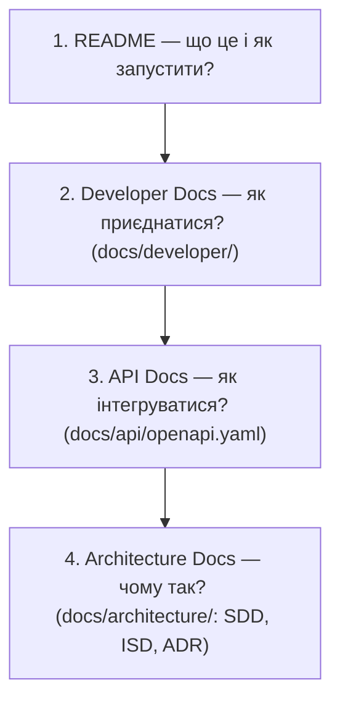

# Project Hub — Лаб.11 «Documentation as Code»

Одна сторінка, з якої відкривається все, що вимагає звіт. Сховище Obsidian — корінь репозиторію Kursova,
гілка `feat/lab11-dac`.

- Публічний сайт документації (GitHub Pages): <https://booooooo76.github.io/kursova-docs/>
- Публічний репозиторій бази знань: <https://github.com/booooooo76/kursova-docs>
- Звіт PDF: `Лаб 11\Zvit_Lab11_DaC.pdf`

## Стан вимог

- [x] Піраміда документації й `mkdocs.yml`
- [x] База знань: граф Obsidian, кущ ADR, front matter
- [x] API-контракт: OpenAPI, Swagger UI, Spectral 0 errors, SDK
- [x] CI/CD: workflow, краш-тест FAIL → PASS
- [x] Регламент: docs-or-don't-merge, аудит `review_date`, деприкація
- [x] Посилання на GitHub Pages
- [ ] Лог діалогу з ШІ (експортує студент, додається окремим файлом)

## 1. Чотирирівнева піраміда і MkDocs



| Рівень | Сторінки |
|---|---|
| 1. README | `README.md` (головна сайту вставляє його, факти не дублюються) |
| 2. Розробникам | [[CONTRIBUTING]], [[local-setup]], [[code-standards]] |
| 3. API | [[api/index\|Огляд API]], [[openapi-contract]], [[reference]] |
| 4. Архітектура | [[sdd]], [[isd]], [[adr/index\|ADR]], [[maintenance]], [[handover]] |

Конфігурація сайту: `mkdocs.yml` у корені репо (тема Material, `strict`, `exclude_docs`, хук
`docs_hooks/wikilinks.py` перетворює `[[вікі-посилання]]` Obsidian на звичайні посилання MkDocs).
Локальна перевірка: `.\venv\Scripts\mkdocs.exe build --strict`.

## 2. База знань: граф, ADR, front matter

![[t1_obsidian_graph.png]]

Кущ ADR ([[adr/index|реєстр]]):

| ADR | Рішення | Статус |
|---|---|---|
| [[0001-postgresql-psycopg2]] | PostgreSQL і чистий SQL через psycopg2 без ORM | Accepted |
| [[0002-privacy-by-design-module]] | приватність окремим модулем | Accepted |

Канон: номер не перевикористовується, прийнятий ADR не редагується — його заміщає новий зі статусом
`Superseded by`.

Приклад паспорта front matter (ця ж сторінка має такий самий):

```yaml
---
title: ADR-0001 PostgreSQL без ORM
owner: Загребенюк Б. (booooooo76)
status: published        # draft | published | deprecated
review_date: 2027-05-21  # перевіряє tools/doc_review_dates.py у CI
tags:
  - architecture
---
```

Власники розділів — `.github/CODEOWNERS`.

## 3. API-контракт (API-first, SSOT)

Єдине джерело — `docs/api/openapi.yaml` (OpenAPI 3.0.3, версія API 1.0.1, 4 реальні маршрути, спільна схема
`Error`). З нього рендеряться [[reference]] на сайті і Swagger UI у застосунку (`/api/docs`).

![[t2_site_swagger.png]]
![[t2_swagger_try_it_out.png]]

Лінтинг Spectral (`.spectral.yaml`) — 0 errors:

![[t2_spectral.png]]

SDK (OpenAPI Generator у Docker, `Лаб 11\sdk-client`):

![[t2_sdk.png]]

Журнали: `docs/lab11/data/sdk_generate.log`, `sdk_tree_and_smoke.txt`, `schemathesis.log`.

## 4. CI/CD і краш-тест «не збирається — не їде»

Workflow: `.github/workflows/docs.yml` (markdownlint → Spectral → `review_date` → `mkdocs build --strict` →
deploy на Pages). Протокол: [[crash_test]].

| Запуск | Коміт | Результат |
|---|---|---|
| #3 45029668763 | `03b316a` бите посилання `rollback-runbook.md` | ❌ build, deploy пропущено |
| #4 45029806721 | `eab75fd` посилання виправлено | ✅ build + deploy |

Червоний Job:

![[t3_2_ci_red_job.png]]

Зелений Job:

![[t3_4_ci_green_job.png]]

![[t3_5_ci_runs_list.png]]

## 5. Регламент безперервного супроводу

- Чек-лист docs-or-don't-merge: [[CONTRIBUTING#Definition of Done: docs-or-don't-merge]], PR-шаблон
  `.github/pull_request_template.md`.
- Регламент власників, циклів і тригерів: [[maintenance]].
- Автоматизований аудит `review_date` (`tools/doc_review_dates.py`, крок CI):

![[t3_8_review_audit.png]]

- Деприкація: застарілі сторінки отримують `status: deprecated` і переносяться в `docs/archive/`
  (приклад: архів старої схеми БД). Знімки документації — теги `docs-v1.0` і `docs-v2.0`.

## 6. Опублікований сайт

<https://booooooo76.github.io/kursova-docs/>

![[t3_6_site_home.png]]

## 7. Лог валідації ШІ-Техліда

Експорт діалогу з ШІ-асистентом додається до звіту окремим файлом. Протокол краш-тесту — [[crash_test]].
