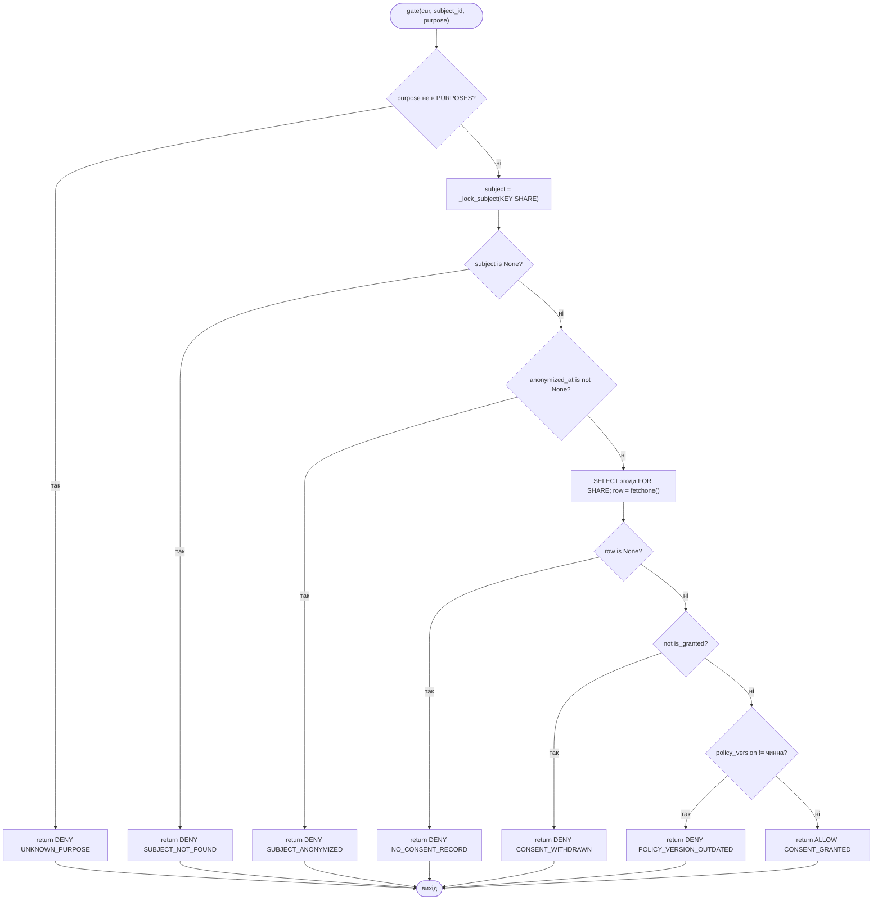
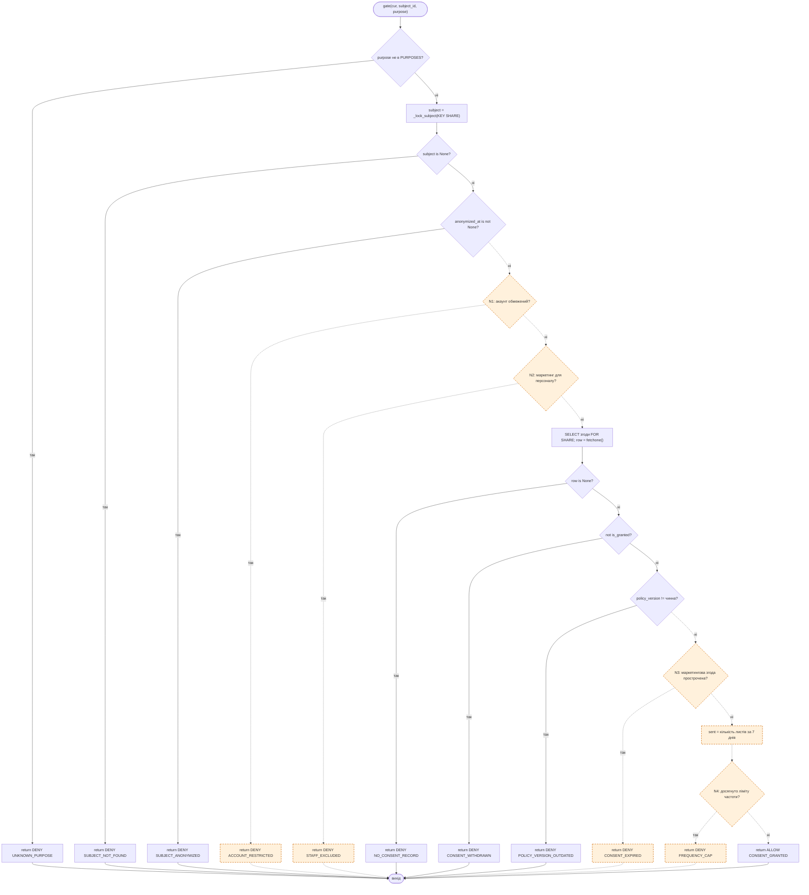
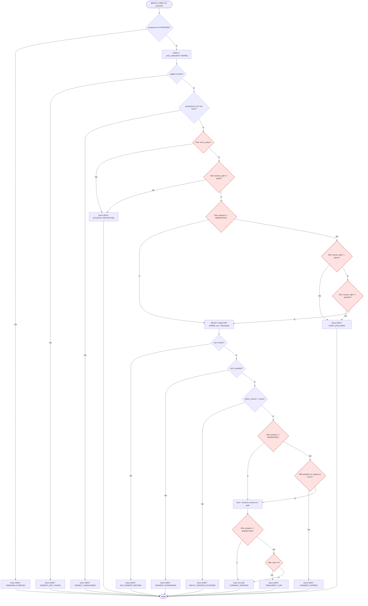

# Лаб.6, Завдання 2. Граф CFG, верифікація Мак-Кейба та Data-Driven рефакторинг

## 1. Обраний метод

`privacy/consent.py :: gate(cur, subject_id, purpose)` з бізнес-модуля (Core Domain, Завд.1). Це Policy Gate:
перед кожною дією, що залежить від згоди (маркетинговий лист, подія аналітики), він вирішує ALLOW або DENY і
повертає код причини. Метод складається з ланцюжка перевірок, тобто його логіка і є таблицею «умова → результат»,
що робить його природним кандидатом для Data-Driven рефакторингу.

Базова цикломатична складність за CLI: **CC = 7** (radon `B (7)`, lizard `CCN 7`).

```python
def gate(cur, subject_id, purpose):
    if purpose not in PURPOSES:
        return Decision(False, R_UNKNOWN_PURPOSE, purpose)
    subject = _lock_subject(cur, subject_id, 'KEY SHARE')
    if subject is None:
        return Decision(False, R_NOT_FOUND, purpose)
    if subject['anonymized_at'] is not None:
        return Decision(False, R_ANONYMIZED, purpose)

    cur.execute('SELECT is_granted, policy_version FROM user_consents '
                'WHERE user_id = %s AND purpose = %s FOR SHARE', (subject_id, purpose))
    row = cur.fetchone()
    if row is None:
        return Decision(False, R_NO_RECORD, purpose)
    if not row['is_granted']:
        return Decision(False, R_WITHDRAWN, purpose)
    if row['policy_version'] != CURRENT_POLICY_VERSION[purpose]:
        return Decision(False, R_OUTDATED, purpose)
    return Decision(True, R_GRANTED, purpose)
```

## 2. Базовий граф CFG

Вузли це лінійні оператори та команди, ромби це предикатні вузли (точки розгалуження), стрілки це ребра (передача
керування). Кожен `return` веде до спільного вузла виходу.



**Ручний розрахунок.**

| Елемент | Що входить | Кількість |
|---|---|---|
| Вузли N | START, P1–P6 (6 предикатів), S1, S2 (2 лінійні блоки), R1–R7 (7 повернень), EXIT | 1 + 6 + 2 + 7 + 1 = **17** |
| Ребра E | START→P1 (1); по 2 з кожного з 6 предикатів (12); S1→P2, S2→P4 (2); R1–R7→EXIT (7) | 1 + 12 + 2 + 7 = **22** |
| CC | E − N + 2 = 22 − 17 + 2 | **7** |
| Контроль | предикатів P = 6, CC = P + 1 | **7** |

Збіг із CLI: radon `F 223:0 gate - B (7)`, lizard `CCN 7`. Перевірка підрахунку вузлів і ребер саме цієї схеми:
`python tools/cfg_count.py docs/lab6/cfg.md --block baseline`.

## 3. Теоретичне розширення на папері

Бізнес хоче чотири нові правила Policy Gate:

| № | Правило | Чому |
|---|---|---|
| N1 | обмежений акаунт: заблокований (`is_active = false`) або ще гостьовий (`access_right = 'guest'`) → DENY `ACCOUNT_RESTRICTED` | не можна обробляти дані за згодою акаунта, який не підтверджений або заблокований |
| N2 | маркетинг не надсилаємо персоналу (`admin` або `operator`) → DENY `STAFF_EXCLUDED` | службові акаунти не є клієнтами розсилки |
| N3 | маркетингова згода, надана понад 12 місяців тому, вважається простроченою → DENY `CONSENT_EXPIRED` | згоду на розсилку періодично перепитують |
| N4 | ліміт частоти: щонайменше 3 надіслані листи за 7 днів → DENY `FREQUENCY_CAP` | захист від спаму |

На кресленні нові вузли й ребра пунктирні. N1 і N2 стають після перевірки анонімізації (до читання згоди), N3 і N4
після перевірки версії політики (перед ALLOW); перед N4 з'являється новий лінійний блок S3 (підрахунок листів).



**«Паперовий» прогноз.**

| Зміна | Вузли | Ребра |
|---|---|---|
| 4 нові предикати N1–N4 | +4 | кожен вставлено в наявне ребро (старе ребро зникає, з'являються вхід і вихід «ні»: +1) і має вихід «так» (+1): +8 |
| 4 нові повернення R8–R11 | +4 | R8–R11 → EXIT: +4 |
| новий лінійний блок S3 | +1 | вставлено в ребро N3 → N4: +1 |
| **разом** | **ΔN = +9 → N = 26** | **ΔE = +13 → E = 35** |

Прогноз: **CC = E − N + 2 = 35 − 26 + 2 = 11** (контроль: 10 предикатів + 1 = 11). Приріст ΔCC = ΔE − ΔN = 13 − 9 = **+4**,
по одиниці на кожен новий предикат; лінійний блок S3 складність не змінює (+1 вузол і +1 ребро).

Про формулювання методички «4 нові предикатні точки та 6 ребер»: за формулою ΔCC = ΔE − ΔN. Чотири бінарні
предикати, вставлені в граф, завжди дають ΔCC = +4, тобто ΔE − ΔN = 4. Варіант «+4 вузли й +6 ребер» дав би ΔCC = +2,
що суперечило б правилу CC = P + 1, тому на кресленні наведено фактичну кількість вузлів і ребер.

## 4. FAIL: код за кресленням і перевірка прогнозу

Правила N1–N4 дописано в `gate` строго за кресленням, однією монолітною функцією (коміт
`feat(audit): simulate topological CC failure, FAIL`). Бізнес сформулював їх складеними умовами:

```python
    if not subject['is_active'] or subject['access_right'] == 'guest':                                   # N1
        return Decision(False, R_ACCOUNT_RESTRICTED, purpose)
    if purpose == MARKETING_EMAIL and (subject['access_right'] == 'admin' or subject['access_right'] == 'operator'):  # N2
        return Decision(False, R_STAFF_EXCLUDED, purpose)
    ...
    if purpose == MARKETING_EMAIL and row['granted_at'] < datetime.now(timezone.utc) - MARKETING_CONSENT_TTL:  # N3
        return Decision(False, R_CONSENT_EXPIRED, purpose)
    cur.execute("SELECT count(*) AS n FROM marketing_outbox WHERE user_id = %s AND status = 'SENT' "
                "AND processed_at > now() - interval '7 days'", (subject_id,))                         # S3
    sent = cur.fetchone()['n']
    if purpose == MARKETING_EMAIL and sent >= MARKETING_WEEKLY_CAP:                                     # N4
        return Decision(False, R_FREQUENCY_CAP, purpose)
```

**Результат CLI: CC = 16** (radon `F 232:0 gate - C (16)`, lizard `CCN 16` і попередження про перевищення порога 15).
Ліміт CC > 15 перетнуто, стан FAIL.

**Прогноз не збігся: 11 на папері проти 16 у сканера.** Різниця 5 дорівнює кількості логічних операторів у нових
умовах: `or` у N1, `and` і `or` у N2, `and` у N3, `and` у N4. Помилка моделі: на кресленні кожне правило було *одним*
ромбом, але Python обчислює `and`/`or` **скорочено** (short-circuit): `a and b` спершу перевіряє `a` і лише якщо воно
істинне, перевіряє `b`. Тобто складена умова з k частин це k окремих точок розгалуження, і сканери рахують саме так:
radon додає +1 за кожен додатковий операнд `and`/`or`, lizard +1 за кожне слово `and`/`or`.

| Правило | Умова | Атомарних предикатів |
|---|---|---|
| N1 | `not is_active` **or** `access_right == 'guest'` | 2 |
| N2 | `purpose == MARKETING` **and** (`role == 'admin'` **or** `role == 'operator'`) | 3 |
| N3 | `purpose == MARKETING` **and** `granted_at < now − 12 міс.` | 2 |
| N4 | `purpose == MARKETING` **and** `sent ≥ 3` | 2 |
| **разом** | | **9** (а не 4) |

Уточнений граф: кожну складену умову розгорнуто в ланцюжок атомарних ромбів (N1a, N1b, …).



| Граф | Вузли N | Ребра E | CC = E − N + 2 | Предикатів P (P + 1) |
|---|---|---|---|---|
| базовий | 17 | 22 | 7 | 6 (7) |
| паперовий прогноз | 26 | 35 | 11 | 10 (11) |
| уточнений (короткозамкнені `and`/`or`) | 31 | 45 | **16** | 15 (16) |

Уточнена модель збіглася з radon і lizard на 100%: **CC = 16**. Висновок для інженера: прогнозуючи складність,
рахувати треба не «правила», а атомарні умови; кожен `and`/`or` це ще одна гілка, яку треба покрити тестом.

Поведінку нових правил зафіксовано тестами `tests/test_consent_rules.py` (11 тестів): вони мають лишитися
зеленими після рефакторингу.

## 5. PASS: Data-Driven рефакторинг (таблиця правил)

Замість дроблення функції (Extract Method) логіку рішення винесено у **статичну структуру даних**: впорядковану
таблицю «умова → причина» `GATE_RULES`. Метод `gate` більше не містить жодного `if`: він збирає факти й бере з
таблиці першу причину, умова якої істинна (коміт `refactor(audit): eliminate conditional branches using lookup table, PASS`).

**До (FAIL, CC = 16):** 10 операторів `if` і 5 логічних операторів у тілі методу (лістинг у п. 4).

**Після (PASS, CC = 1):**

```python
GATE_RULES = (
    (lambda f: f.purpose not in PURPOSES,                                                  R_UNKNOWN_PURPOSE),
    (lambda f: f.subject is None,                                                          R_NOT_FOUND),
    (lambda f: f.subject['anonymized_at'] is not None,                                     R_ANONYMIZED),
    (lambda f: not f.subject['is_active'] or f.subject['access_right'] == 'guest',         R_ACCOUNT_RESTRICTED),
    (lambda f: f.purpose == MARKETING_EMAIL and f.subject['access_right'] in STAFF_ROLES,  R_STAFF_EXCLUDED),
    (lambda f: f.row is None,                                                              R_NO_RECORD),
    (lambda f: not f.row['is_granted'],                                                    R_WITHDRAWN),
    (lambda f: f.row['policy_version'] != CURRENT_POLICY_VERSION[f.purpose],               R_OUTDATED),
    (lambda f: f.purpose == MARKETING_EMAIL and f.row['granted_at'] < f.now - MARKETING_CONSENT_TTL, R_CONSENT_EXPIRED),
    (lambda f: f.purpose == MARKETING_EMAIL and f.sent_last_week >= MARKETING_WEEKLY_CAP,  R_FREQUENCY_CAP),
)
NO_RULE_MATCHED = (None, R_GRANTED)


def gate(cur, subject_id, purpose):
    facts = _gate_facts(cur, subject_id, purpose)
    _, reason = next(filter(lambda rule: rule[0](facts), GATE_RULES), NO_RULE_MATCHED)
    return Decision(reason == R_GRANTED, reason, purpose)
```

Як це працює:
1. `_gate_facts` (CC = 1) лінійно читає з БД усе, що потрібно для рішення: рядок користувача (з блокуванням KEY SHARE),
   запис згоди (FOR SHARE) і кількість листів за тиждень. Порядок блокувань той самий, що в командах (keys → згода),
   тож захист від гонки й від deadlock збережено.
2. `filter` перебирає рядки таблиці **ліниво** і зупиняється на першій істинній умові. Тому рядок, що звертається до
   `subject` чи `row`, ніколи не виконується раніше, ніж рядок, який уже перевірив, що ці записи існують: пріоритет і
   безпека старого ланцюжка `if` збережені.
3. Якщо жодна умова не спрацювала, береться `NO_RULE_MATCHED`, тобто ALLOW.

Чому це саме Data-Driven, а не Extract Method: розгалуження не перенесено в інші функції, їх **немає** як коду керування.
Правило тепер це рядок таблиці; нове правило додається новим рядком, і CC методу від цього не росте.
Умови в рядках таблиці лишаються логічними виразами (`and`/`or`), але це дані-предикати, а не гілки керування методу,
тому вони не впливають на складність `gate`.

**Результат CLI:** `gate - A (1)` (radon), `CCN 1` (lizard); `lizard -C 10` по всьому файлу: «No thresholds exceeded».
Поведінку перевірено тими самими тестами, що й у стані FAIL: `tests/test_consent_rules.py` (11) і `tests/test_consent.py`
(43) зелені, весь набір 230 тестів зелений.

## 6. Підсумок трьох станів

| Стан | Коміт | CC `gate` (radon / lizard) | Ручний розрахунок | Вердикт |
|---|---|---|---|---|
| Baseline | `docs(audit): Baseline - граф CFG для consent.gate, CC=7 …` | 7 / 7 | 22 − 17 + 2 = 7 | норма |
| FAIL | `feat(audit): simulate topological CC failure, FAIL` | 16 / 16 | папір 11, уточнений граф 45 − 31 + 2 = 16 | CC > 15 |
| PASS | `refactor(audit): eliminate conditional branches using lookup table, PASS` | 1 / 1 | граф: START → факти → вибір із таблиці → return → вихід, 4 − 5 + 2 = 1 | CC ≤ 2 |
