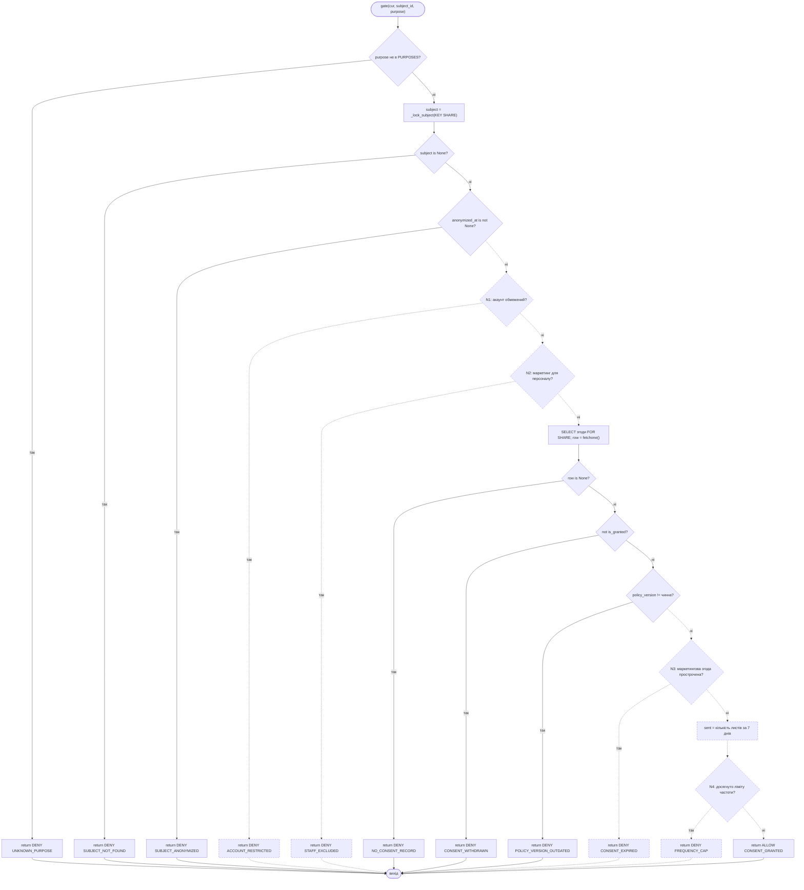

# Лаб.6, Завдання 2. Граф CFG, верифікація Мак-Кейба та Data-Driven рефакторинг

## 1. Обраний метод

`privacy/consent.py :: gate(cur, subject_id, purpose)` з бізнес-модуля (Core Domain, Завд.1). Це Policy Gate:
перед кожною дією, що залежить від згоди (маркетинговий лист, подія аналітики), він вирішує ALLOW або DENY і
повертає код причини. Метод складається з ланцюжка перевірок, тобто його логіка і є таблицею «умова → результат»,
що робить його природним кандидатом для Data-Driven рефакторингу.

Базова цикломатична складність за CLI: **CC = 7** (radon `B (7)`, lizard `CCN 7`).

```python
def gate(cur, subject_id, purpose):
    if purpose not in PURPOSES:
        return Decision(False, R_UNKNOWN_PURPOSE, purpose)
    subject = _lock_subject(cur, subject_id, 'KEY SHARE')
    if subject is None:
        return Decision(False, R_NOT_FOUND, purpose)
    if subject['anonymized_at'] is not None:
        return Decision(False, R_ANONYMIZED, purpose)

    cur.execute('SELECT is_granted, policy_version FROM user_consents '
                'WHERE user_id = %s AND purpose = %s FOR SHARE', (subject_id, purpose))
    row = cur.fetchone()
    if row is None:
        return Decision(False, R_NO_RECORD, purpose)
    if not row['is_granted']:
        return Decision(False, R_WITHDRAWN, purpose)
    if row['policy_version'] != CURRENT_POLICY_VERSION[purpose]:
        return Decision(False, R_OUTDATED, purpose)
    return Decision(True, R_GRANTED, purpose)
```

## 2. Базовий граф CFG

Вузли це лінійні оператори та команди, ромби це предикатні вузли (точки розгалуження), стрілки це ребра (передача
керування). Кожен `return` веде до спільного вузла виходу.


**Ручний розрахунок.**

| Елемент | Що входить | Кількість |
|---|---|---|
| Вузли N | START, P1–P6 (6 предикатів), S1, S2 (2 лінійні блоки), R1–R7 (7 повернень), EXIT | 1 + 6 + 2 + 7 + 1 = **17** |
| Ребра E | START→P1 (1); по 2 з кожного з 6 предикатів (12); S1→P2, S2→P4 (2); R1–R7→EXIT (7) | 1 + 12 + 2 + 7 = **22** |
| CC | E − N + 2 = 22 − 17 + 2 | **7** |
| Контроль | предикатів P = 6, CC = P + 1 | **7** |

Збіг із CLI: radon `F 223:0 gate - B (7)`, lizard `CCN 7`. Перевірка підрахунку вузлів і ребер саме цієї схеми:
`python tools/cfg_count.py docs/lab6/cfg.md --block baseline`.

## 3. Теоретичне розширення на папері

Бізнес хоче чотири нові правила Policy Gate:

| № | Правило | Чому |
|---|---|---|
| N1 | обмежений акаунт: заблокований (`is_active = false`) або ще гостьовий (`access_right = 'guest'`) → DENY `ACCOUNT_RESTRICTED` | не можна обробляти дані за згодою акаунта, який не підтверджений або заблокований |
| N2 | маркетинг не надсилаємо персоналу (`admin` або `operator`) → DENY `STAFF_EXCLUDED` | службові акаунти не є клієнтами розсилки |
| N3 | маркетингова згода, надана понад 12 місяців тому, вважається простроченою → DENY `CONSENT_EXPIRED` | згоду на розсилку періодично перепитують |
| N4 | ліміт частоти: щонайменше 3 надіслані листи за 7 днів → DENY `FREQUENCY_CAP` | захист від спаму |

На кресленні нові вузли й ребра пунктирні. N1 і N2 стають після перевірки анонімізації (до читання згоди), N3 і N4
після перевірки версії політики (перед ALLOW); перед N4 з'являється новий лінійний блок S3 (підрахунок листів).



**«Паперовий» прогноз.**

| Зміна | Вузли | Ребра |
|---|---|---|
| 4 нові предикати N1–N4 | +4 | кожен вставлено в наявне ребро (старе ребро зникає, з'являються вхід і вихід «ні»: +1) і має вихід «так» (+1): +8 |
| 4 нові повернення R8–R11 | +4 | R8–R11 → EXIT: +4 |
| новий лінійний блок S3 | +1 | вставлено в ребро N3 → N4: +1 |
| **разом** | **ΔN = +9 → N = 26** | **ΔE = +13 → E = 35** |

Прогноз: **CC = E − N + 2 = 35 − 26 + 2 = 11** (контроль: 10 предикатів + 1 = 11). Приріст ΔCC = ΔE − ΔN = 13 − 9 = **+4**,
по одиниці на кожен новий предикат; лінійний блок S3 складність не змінює (+1 вузол і +1 ребро).

Про формулювання методички «4 нові предикатні точки та 6 ребер»: за формулою ΔCC = ΔE − ΔN. Чотири бінарні
предикати, вставлені в граф, завжди дають ΔCC = +4, тобто ΔE − ΔN = 4. Варіант «+4 вузли й +6 ребер» дав би ΔCC = +2,
що суперечило б правилу CC = P + 1, тому на кресленні наведено фактичну кількість вузлів і ребер.

<!-- Розділи 4 (FAIL: верифікація прогнозу) і 5 (PASS: Lookup Table) додаються на наступних етапах. -->
