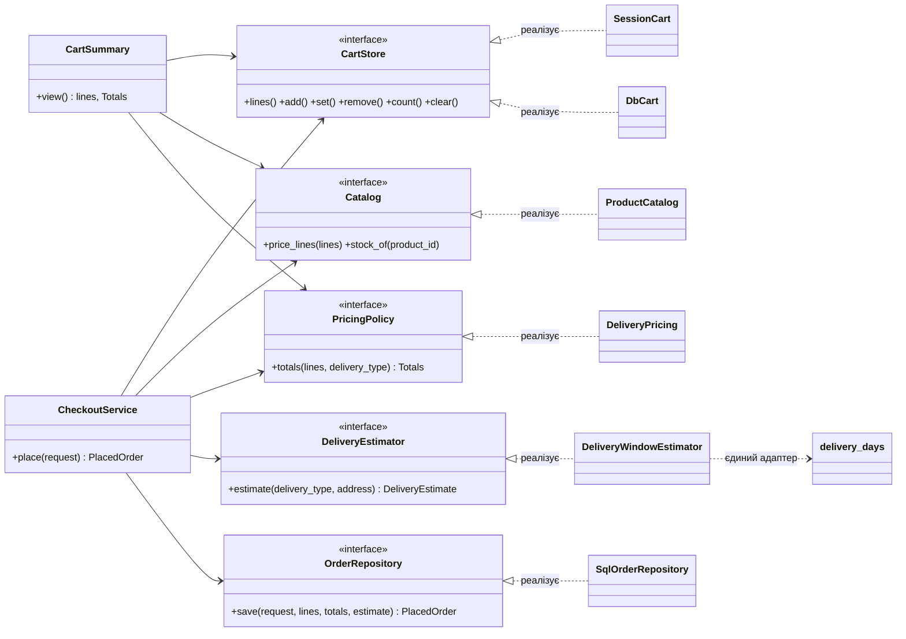

# Лаб.8, Завдання 2. God Object: локалізація, Shotgun Surgery і інтерфейсна декомпозиція

## 1. Епіцентр хаосу і шлях виконання

За Завд.1 класу з CBO > 15 у проєкті немає (максимум 6), а хаос зосереджено на рівні модуля `app.py` (47 функцій,
fan-out 106). Тому застосовано шлях методички **«метод штучної агрегації»**: логіку оформлення замовлення, розпорошену
по функціях і маршрутах `app.py` (`get_cart_from_session`, `save_cart_to_session`, `get_user_cart`,
`calculate_cart_total`, тіла маршрутів `cart`, `add_to_cart`, `remove_from_cart`, `update_cart`, `cart_count`,
`checkout`, `create_order`, перенесення кошика після входу), зібрано в монолітний клас `services/order_manager.py ::
OrderManager`. До нього додано оцінку терміну доставки з `models/delivery.py` (Лаб.6).

Поведінку зафіксовано **характеризаційними тестами** `tests/test_order_flow.py` (18 тестів: кошик гостя й користувача,
ліміт складу, суми й доставка, позиції, залишки, очищення кошика, термін доставки в повідомленні й примітці) **до**
перенесення коду (коміт `99a552f`), і вони зелені в кожному стані, крім FAIL.

## 2. Baseline (коміт `de3b723`)

| Метрика (tools/oo_metrics.py) | OrderManager | Поріг методички |
|---|---|---|
| CBO | **18** | > 15 = мутант |
| LCOM* (Henderson-Sellers) | **0,91** | ≈ 1 = мутант |
| WMC | 57 | |
| RFC | 57 | |
| PIM (публічних методів) | 24 | |
| Sonar API: complexity / functions / ncloc | 54 / 26 / 188 | |

Зачеплений з 18 сутностями трьох різних світів: HTTP (`session`, `request.form`, `request.get_json`, `flash`, `redirect`,
`url_for`, `render_template`, `jsonify`, `current_user`), дані (`execute_query`, `get_db_connection`, `RealDictCursor`) і
бізнес-правила / інфраструктура (`delivery_days`, `datetime.now`, `re.search`, `logging.getLogger`, `security_event`,
`record_analytics_event_safely`). LCOM* 0,91: методи кошика, грошей, доставки й запису замовлення працюють з різними
полями, тобто клас склеєний з кількох незалежних.

Матриця зв'язності (`tools/coupling_matrix.py`; SonarQube 9.9 Community такої матриці не має): рядок `OrderManager`
зафарбований у 18 стовпцях, інші класи проєкту мають CBO 2–6. Граф-«зірка» показує ті самі 18 стрілок.

## 3. FAIL: Shotgun Surgery (коміт `arch(audit): capture god object coupling failure, FAIL`)

Точкова бізнес-зміна в сторонньому модулі: перевізник гарантує не день, а **вікно доставки**, тож
`models.delivery.delivery_days()` тепер повертає `(найраніше, найпізніше)` замість одного числа. Модуль доставки змінено
коректно, його власні 16 тестів оновлено й вони зелені. Але God Object «приварений» до формату результату в трьох місцях:

| Метод OrderManager | Що робить з результатом | Що сталося |
|---|---|---|
| `delivery_label(days)` | `'сьогодні' if days == 0 else f'{days} роб. дн.'` | текст «(2, 3) роб. дн.» |
| `order_notes(days)` | вставляє мітку в примітку | **спотворений текст записано в БД** |
| `is_fast_delivery(days)` | `days <= 1` | `TypeError: '<=' not supported between instances of 'tuple' and 'int'` |

Найгірше, що `TypeError` виникає **після** запису замовлення й очищення кошика: покупець бачить «Помилка при створенні
замовлення» і повертається на оформлення, хоча замовлення вже створене (ризик повторної оплати). Тести: **9 failed**
(усі 4 параметризації сум і доставки, 4 повідомлення з терміном, примітка), 25 passed.

## 4. PASS: інтерфейсна декомпозиція (коміт `refactor(audit): eliminate god object via interface decomposition, PASS`)

| Відповідальність (SRP) | Клас | Контракт | Файл |
|---|---|---|---|
| Кошик: де лежать позиції | `SessionCart` (гість), `DbCart` (користувач) | `CartStore` | `services/cart.py` |
| Каталог: ціни й залишки | `ProductCatalog` | `Catalog` | `services/cart.py` |
| Гроші: суми й доставка (правила як дані) | `DeliveryPricing` | `PricingPolicy` | `services/pricing.py` |
| Термін доставки: адаптер до `delivery_days` | `DeliveryWindowEstimator` | `DeliveryEstimator` | `services/delivery_estimate.py` |
| Запис замовлення в одній транзакції | `SqlOrderRepository` | `OrderRepository` | `services/orders.py` |
| Сценарії | `CheckoutService`, `CartSummary` | лише контракти | `services/checkout.py` |

* **Dependency Inversion:** оркестратори залежать від `typing.Protocol` у `services/contracts.py`, а не від конкретних
  класів. **Dependency Injection:** реалізації передаються в конструктор; збирає їх `services/composition.py`
  (Composition Root). HTTP (форма, flash, redirect, json) лишився в маршрутах `app.py`, сервіс про Flask не знає.
* Обмін даними: незмінні Value Objects `services/values.py` (`CartLine`, `Totals`, `DeliveryEstimate`, `OrderRequest`,
  `PlacedOrder`), як у Лаб.7.
* Та сама бізнес-зміна тепер ізольована: формат `delivery_days` знає **один рядок** (`DeliveryWindowEstimator.estimate`),
  а як показувати вікно, вирішує `DeliveryEstimate.label`. Доказ розв'язності: `CheckoutService` протестовано з
  підставними реалізаціями в пам'яті, без Flask і без БД (`tests/test_checkout_services.py`).

## 5. Інструментальна валідація

| Клас | WMC | CBO | RFC | LCOM* | LCOM4 | Sonar API (complexity файлу) |
|---|---|---|---|---|---|---|
| **OrderManager (Baseline)** | 57 | **18** | 57 | **0,91** | 1 | 54 |
| CheckoutService | 3 | **5** | 8 | **0,00** | 1 | 5 (`checkout.py`) |
| CartSummary | 2 | 3 | 5 | 0,00 | 1 | ↑ |
| SessionCart | 11 | 0 | 14 | 0,00 | 1 | 23 (`cart.py`) |
| DbCart | 9 | 0 | 7 | 0,00 | 1 | ↑ |
| ProductCatalog | 9 | 1 | 4 | 0,00 | 1 | ↑ |
| DeliveryPricing | 4 | 1 | 3 | 0,00 | 1 | 3 (`pricing.py`) |
| DeliveryWindowEstimator | 6 | 2 | 5 | 0,00 | 1 | 5 (`delivery_estimate.py`) |
| SqlOrderRepository | 3 | 2 | 8 | 0,00 | 1 | 3 (`orders.py`) |

**Максимальний CBO нового класу 5 ≤ 8, LCOM* = 0 ≤ 0,2** для всіх класів декомпозиції. Тести: **276 passed**.

Примітки до чисел: Value Objects (`Totals`, `OrderRequest`, `DeliveryEstimate`) мають LCOM* 0,5–1,0, бо це контейнери
даних, кожна властивість яких рахується з окремих полів; до класів-сервісів декомпозиції вони не належать. Протоколи
`services/contracts.py` мають DIT 3 лише через базовий `typing.Protocol`; самі реалізації його не успадковують (DIT 1).
