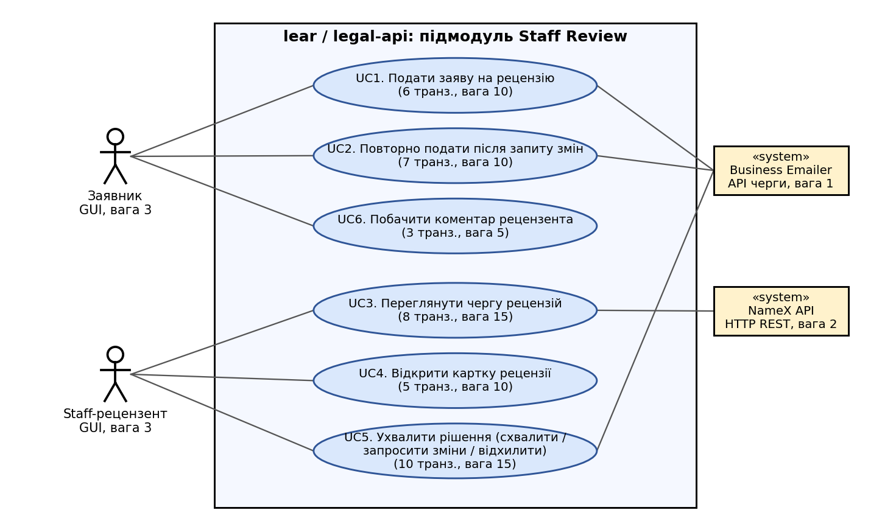

# Лаб.9, Завд.3 — Функціональний розмір підмодуля (FPA & UCP) і калібрування продуктивності

## Об'єкт: підмодуль Staff Review у bcgov/lear

Staff Review — це ручна перевірка заяв **continuation-in** (перенесення компанії з іншої юрисдикції в BC) працівником
реєстру. Заявник подає заяву, вона потрапляє в чергу, staff-рецензент схвалює її, відхиляє або запитує зміни, а
заявник отримує лист і бачить коментар.

Клон для аналізу: `Лаб 9\oss\lear` (blobless + sparse checkout), коміт `65487f60` від 13.11.2026.

| Файл | Класи / функції |
|---|---|
| `python/common/business-registry-model/src/business_model/models/review.py` | `ReviewStatus` (Enum), `Review` (ORM, таблиця `reviews`), `Review.ReviewFilter` (dataclass) |
| `.../models/review_result.py` | `ReviewResult` (ORM, таблиця `review_results`) |
| `legal-api/src/legal_api/resources/v2/admin/reviews.py` | `get_reviews`, `get_review`, `save_review`, хелпери `get_applicable_nr_numbers`, `get_expiry_date_for_each_nr`, `update_reviews`, `get_mapped_column` |
| `legal-api/.../business_filings/business_filings.py` | `ListFilingResource.submit_filing_for_review`, гілка `latestReviewComment` у `get_single_filing` |

## 1. Специфікація реверс-інжинірингу

### ORM-сутності (джерело для даних FPA)

```python
class ReviewStatus(BaseEnum):  AWAITING_REVIEW, CHANGE_REQUESTED, RESUBMITTED, APPROVED, REJECTED

class Review(db.Model):                     # __tablename__ = 'reviews'
    id, nr_number, identifier, contact_email, status: ReviewStatus,
    submission_date, creation_date, filing_id -> filings.id
    review_results = relationship('ReviewResult')
    save(); find_by_id(review_id); get_review(filing_id);
    get_paginated_reviews(review_filter, mapped_sort_by_column); json

class ReviewResult(db.Model):               # __tablename__ = 'review_results'
    id, status: ReviewStatus, comments, reviewer_id -> users.id,
    creation_date, submission_date, review_id -> reviews.id (NOT NULL)
    get_review_results(review_id); get_last_review_result(filing_id); json
```

Чужі дані, які модуль лише читає або змінює через чужі методи: `Filing` (`find_by_id`, `set_review_decision`,
`submit_filing_to_awaiting_review`), `User` (`get_or_create_user_by_jwt`, `display_name`), NameX
(`namex.query_nr_numbers` → `POST {NAMEX_SVC_URL}/requests/search`).

### API-ендпоінти (джерело для транзакцій FPA та прецедентів UCP)

| Маршрут | Функція | Роль |
|---|---|---|
| `GET /api/v2/admin/reviews?startDate&endDate&nrNumber&identifier&contactEmail&status&sortBy&sortDesc&page&limit` | `get_reviews()` | staff |
| `GET /api/v2/admin/reviews/<int:review_id>` | `get_review(review_id)` | staff |
| `POST /api/v2/admin/reviews/<int:review_id>` `{status, comment}` | `save_review(review_id)` | staff |
| `POST/PUT /api/v2/businesses/<identifier>/filings[/<filing_id>]` (staffApprovalRequired) | `saving_filings` → `submit_filing_for_review(business, filing)` | заявник |
| `GET /api/v2/businesses/<identifier>/filings/<filing_id>` | `get_single_filing` → `header.latestReviewComment` | заявник |

Вихідна подія: `publish_to_queue({"email": {filingId, type, option}}, BUSINESS_EMAILER_TOPIC)` → сервіс Business Emailer.

### Актори та прецеденти

Діаграма: `docs/lab9/usecase_staff_review.drawio` (draw.io) і `usecase_staff_review.png`.



## 2. FPA калькулятор (IFPUG Ledger)

Межа вимірювання: підмодуль Staff Review. Таблиця `filings` належить модулю Filing: Staff Review змінює її статус лише
через методи самого `Filing`, тому для нас це EIF, а не ILF. `review_results` не існує без `reviews` (FK NOT NULL) і для
користувача є історією рішень однієї рецензії, тож це один ILF з 2 RET, а не два окремі файли.

| ID | Тип | Функція | DET | RET/FTR | Складність | FP |
|---|---|---|---:|---:|---|---:|
| D1 | ILF | Рецензія з історією рішень (reviews + review_results) | 13 | 2 RET | Простий | 7 |
| D2 | EIF | Заява (filings) | 7 | 1 RET | Простий | 5 |
| D3 | EIF | Користувач-рецензент (users) | 3 | 1 RET | Простий | 5 |
| D4 | EIF | Name Request (NameX) | 2 | 1 RET | Простий | 5 |
| T1 | EI | Подати заяву на рецензію | 7 | 2 FTR | Середній | 4 |
| T2 | EI | Повторно подати після CHANGE_REQUESTED | 7 | 2 FTR | Середній | 4 |
| T3 | EI | Зберегти рішення рецензента | 5 | 3 FTR | Складний | 6 |
| T4 | EO | Черга рецензій (фільтри, сортування, total, nrExpiryDate) | 21 | 3 FTR | Складний | 7 |
| T5 | EO | Картка рецензії з обчисленим filingLink | 13 | 3 FTR | Середній | 5 |
| T6 | EQ | Останній коментар рецензента в заяві | 3 | 2 FTR | Простий | 3 |
| | | **Разом** | | | | **51 FP** |

Дані: 7 + 3 × 5 = 22 FP; транзакції: 4 + 4 + 6 + 7 + 5 + 3 = 29 FP; **UFP = 51** (VAF = 1,0, як і TCF/ECF у UCP).

T4 і T5 — це EO, а не EQ, бо вони містять похідні дані: `total` (підрахунок), `nrExpiryDate` (злиття з NameX),
`filingLink` (обчислене посилання). T6 повертає збережений коментар без перетворень, тому це EQ. Повні переліки
DET/FTR для кожного рядка наведено в `docs/lab9/data/fpa_ucp.md`.

## 3. UCP матриця Карнера

| Актор | Інтерфейс | Тип | Вага |
|---|---|---|---:|
| Staff-рецензент BC Registries | людина через GUI | складний | 3 |
| Заявник (бізнес-клієнт) | людина через GUI | складний | 3 |
| NameX API | REST по HTTP | середній | 2 |
| Business Emailer | API черги Pub/Sub | простий | 1 |
| | | **UAW** | **9** |

| UC | Прецедент | Транзакцій (кроки в коді) | Тип | Вага |
|---|---|---:|---|---:|
| UC1 | Подати заяву на рецензію (`submit_filing_for_review`, DRAFT) | 6 | середній | 10 |
| UC2 | Повторно подати після запиту змін (CHANGE_REQUESTED) | 7 | середній | 10 |
| UC3 | Переглянути чергу рецензій (`get_reviews`) | 8 | складний | 15 |
| UC4 | Відкрити картку рецензії (`get_review`) | 5 | середній | 10 |
| UC5 | Ухвалити рішення (`save_review`) | 10 | складний | 15 |
| UC6 | Побачити коментар рецензента (`get_single_filing`) | 3 | простий | 5 |
| | | | **UUCW** | **65** |

UUCP = 9 + 65 = 74; TCF = ECF = 1,0 → **UCP = 74 × 1,0 × 1,0 = 74**.

Як рахувались транзакції, на прикладі UC5 `save_review`: 1) перевірка ролі staff; 2) User з JWT; 3) пошук Review або
404; 4) чи можна ще змінювати статус; 5) валідація нового статусу; 6) обов'язковий коментар для CHANGE_REQUESTED і
REJECTED; 7) створення ReviewResult; 8) оновлення та збереження Review; 9) рішення у Filing; 10) подія листа.
Отже, 10 > 7, тип складний. Кроки решти прецедентів наведено в `docs/lab9/data/fpa_ucp.md`.

## 4. Трудовитрати з історії Git

`tools/git_effort.py` (результат: `docs/lab9/data/git_effort.md`). lear зливає PR одним squash-комітом, тому в `main`
видно тільки дату злиття. Справжні коміти розробників із часовими мітками лишились у PR на GitHub.

1. `git log` клону за файлами модуля (`*review*` у legal-api і business-registry-model, без `review_imported_data`)
   дав 31 squash-коміт. 8 технічних (chore, lint, merge, split моделей у пакет) виключено: вони не додають функцій.
   Лишилось **23 PR**.
2. Через GitHub REST API зібрано 118 початкових комітів цих PR і статистику рядків по файлах.
3. Сесійна модель (як у git-hours): коміти одного автора з інтервалом до 2 год утворюють одну сесію, і час між ними
   додається; кожна нова сесія додає 2 год роботи до першого коміту.
4. Години PR множаться на частку рядків модуля в PR. У «чужих» файлах (наприклад, `business_filings.py`) до модуля
   зараховуються лише змінені рядки, що згадують review.

Результат: **92,9 людино-години**, 5 авторів, основна розробка з 02.07.2024 по 18.10.2024 (PR #2797–#3029).

## 5. Зворотне калібрування

```
PF = трудовитрати / UCP = 92,9 / 74 = 1,26 людино-год на 1 UCP      (для FPA: 92,9 / 51 = 1,82 год на 1 FP)
```

Калькулятор із живими формулами: `docs/lab9/FPA_UCP_calculator.xlsx` (аркуші FPA, Ваги, UCP; зміна DET або кількості
транзакцій одразу перераховує FP, UCP і PF). Генератор: `tools/fpa_ucp.py`.

### Висновок Lead Engineer: як PF допомагає оцінювати Change Requests

1. **Оцінка до першого рядка коду.** Новий запит описують як зміну моделі: які прецеденти й актори додаються або
   ускладнюються (ΔUCP). Далі `години = ΔUCP × PF`, `бюджет = години × HOURLY_RATE × OVERLOAD_COEFF`, тобто ті самі
   параметри, що й у фінансовому симуляторі Завд.2. Приклад: CR «призупинити рецензію (статус ON_HOLD)» дає новий
   прецедент на 5 транзакцій (середній, +10 UCP), черга лише отримує ще одне значення фільтра. Оцінка:
   10 × 1,26 = **12,6 год** активної розробки ≈ 12,6 × $45 × 1,3 = **$734**.
2. **Що саме виміряв PF.** 1,26 год/UCP набагато менше за класичні 20 год/UCP Карнера. Git бачить лише сесії
   кодування між комітами, а аналіз, code review, QA, розгортання й спілкування в коміти не потрапляють. Тому PF з Git
   — це **нижня межа «чистого кодування»**. Для повного бюджету компанія один раз звіряє його з табелем на 2–3
   минулих CR і отримує поправковий коефіцієнт K = PF_табель / PF_git. Надалі оцінка = ΔUCP × PF_git × K.
3. **Керування ризиками.** Із PF видно, де оцінка ненадійна. Прецеденти зі складною логікою (UC3, UC5: 8–10
   транзакцій, інтеграція з NameX і Emailer) зібрали найбільше годин: лише три PR черги UC3 (#2938, #2941, #2956 —
   строк дії NR, дати, фільтри) дали 39,1 год, тобто 42 % усього. Для CR,
   що зачіпає зовнішніх акторів, варто закладати верхню межу діапазону, а PF перекалібровувати після кожного релізу.
4. **FP проти UCP.** Обидві оцінки узгоджені (51 FP і 74 UCP для того самого коду). FP краще підходить для контракту з
   замовником, бо він не залежить від технологій і рахує дані. UCP можна отримати раніше, уже з діаграми прецедентів,
   ще до проєктування БД.
