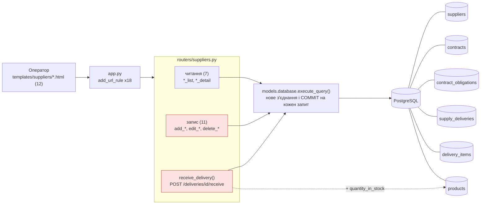
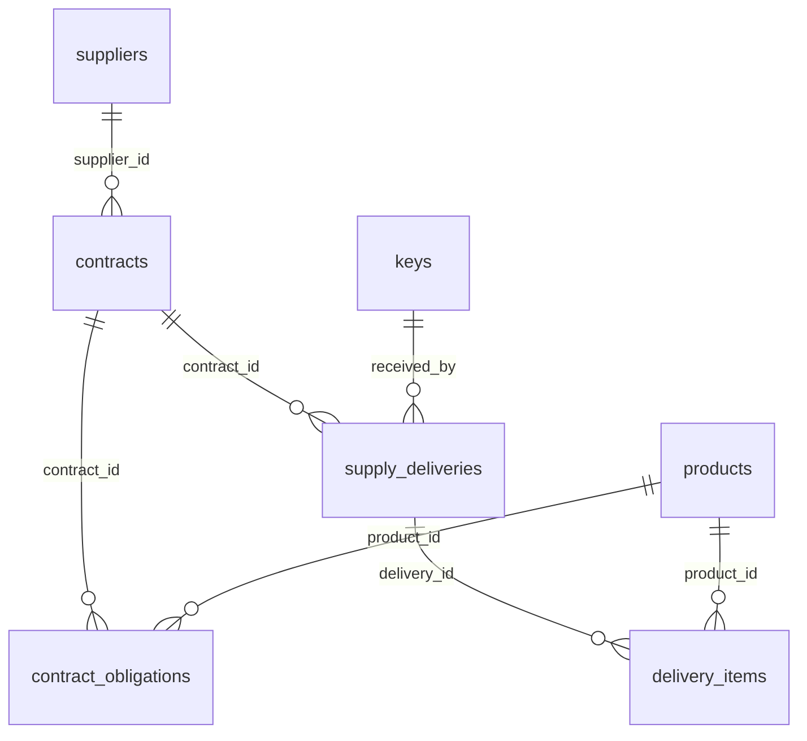

# Legacy-компонент: модуль постачань `routers/suppliers.py`

**Чому саме він.** Аудит Лаб.10 (артефакт A19) показав, що старі модулі `app.py` і `routers/` майже без коментарів.
Серед них `suppliers.py` найгірший: 790 рядків, 19 функцій, **0 docstring-ів**, жодного тесту, у SDD — один рядок.
Останню зміну внесено 2025-11-27, тобто код рік не змінювався. Знання про модуль відновлено з коду інструментально:
`tools/legacy_map.py` → `docs/legacy/data/suppliers.json`.

Рівні довіри: **verified** — перевірено інструментом (ast, information_schema, git, тест або запуск);
**assumed** — гіпотеза з назв і шаблонів, потребує підтвердження власником процесу постачань.

## 1. Призначення

Облік постачальників, договорів поставки (з плановими зобов'язаннями за товарами) і самих поставок. Прийняття
поставки збільшує залишки товарів на складі. Доступ має лише роль operator або admin.

| Твердження | Довіра | Доказ |
|---|---|---|
| 19 функцій, 18 URL, жодного docstring-а, немає docstring-а модуля | verified | `legacy_map.py`: `functions`, `routes`, `module_docstring: false` |
| Доступ лише operator / admin (декоратор `operator_or_admin_required`) | verified | рядки 6–18; 10 маршрутів обгорнуті ще й в `app.py` (подвійна перевірка), 8 — лише в модулі |
| 4 коміти, усі в листопаді 2025, автори — два акаунти власника | verified | `git log -- routers/suppliers.py`: `78c84d0`, `9704f52`, `d67becd`, `f048921` |
| До Лаб.12 тестів на модуль не було | verified | `grep -rl "supply_deliveries" tests/` — лише схема й фабрики |
| Статуси договору: active / completed / cancelled; поставки: expected / received | assumed | шаблони `contracts_list.html`, `edit_contract.html`; у БД немає CHECK на `supply_deliveries.status` |

## 2. Граф залежностей

| Хто викликає модуль | Кого викликає модуль |
|---|---|
| `app.py` — 18 правил `add_url_rule` (verified) | `models.database.execute_query` — 61 виклик, жодного `transaction()` (verified) |
| 12 шаблонів `templates/suppliers/` — форми й посилання (verified) | Flask: `render_template`, `flash`, `redirect`; `flask_login.current_user` (verified) |
| інших модулів-клієнтів немає (verified: `grep "from routers.suppliers"` — лише `app.py`) | `print()` замість журналу — 7 місць до v1.1.0, 6 після (verified) |

## 3. Схема даних

| Таблиця | Ключові колонки | Хто пише | Довіра |
|---|---|---|---|
| `suppliers` | `company_name`, `is_active` | `add_supplier`, `edit_supplier`, `delete_supplier` | verified |
| `contracts` | `contract_number`, `status`, `total_amount`, `paid_amount` | `add_contract`, `edit_contract`; **`paid_amount` не пише жоден код** | verified |
| `contract_obligations` | `planned_quantity`, `planned_price`, **`delivered_quantity`** | `add_contract*`; **`delivered_quantity` ніхто не оновлює**, виконання договору не відстежується | verified |
| `supply_deliveries` | `status` (без CHECK), `delivery_date` (DEFAULT CURRENT_DATE), `received_by` | `add_delivery`, `edit_delivery`, `receive_delivery` | verified |
| `delivery_items` | `ordered_quantity`, **`received_quantity`** | `add_delivery`, `edit_delivery` (видалити й вставити заново); **`received_quantity` ніхто не пише** | verified |
| `products.quantity_in_stock` | залишок | `receive_delivery` (+ кількість у поставці) | verified |
| `received_by` = хто **створив** поставку, а не хто прийняв | — | `add_delivery` пише `current_user` під час створення; `receive_delivery` поле не змінює | verified |
| Частково прийнята поставка (прийшло менше, ніж замовлено) не підтримується | — | немає коду для `received_quantity` | assumed (вимога бізнесу невідома) |

## 4. Ключові методи

| Метод | Що робить | SQL / записів | Ризик | Довіра |
|---|---|---|---|---|
| `add_delivery()` | створює поставку; відмовляє, якщо товару немає в зобов'язаннях договору | 8 / 3 | вставка поставки й позицій окремими COMMIT: збій → поставка без позицій | verified |
| `edit_delivery()` | лише для `expected`; видаляє всі позиції й вставляє знову | 9 / 4 | збій після DELETE → поставка без позицій | verified |
| **`receive_delivery()`** | до v1.1.0: додавала `ordered_quantity` кожної позиції окремим COMMIT; з v1.1.0 (RFC-001): `apply_delivery()` в одній транзакції з `FOR UPDATE` і перевіркою статусу `expected` | 3 запити в 1 транзакції | **виправлено**: повтор не змінює склад, збій відкочує все й пише `delivery_receive_failed` | verified (6 тестів, симуляції PASS) |
| `delete_contract()` | забороняє, якщо є поставки; видаляє зобов'язання, потім договір | 3 / 2 | збій між DELETE → договір без зобов'язань | verified |
| `delete_delivery()` | забороняє для `received`; видаляє позиції, потім поставку | 3 / 2 | те саме | verified |
| `*_list`, `*_detail` | читання з фільтрами; `except Exception` → `print` + flash | — | помилки не потрапляють у журнал і моніторинг | verified |

До INC-001 7 функцій виконували ≥ 2 записи без транзакції (`legacy_map.py`, ознака `non_atomic_multi_write`):
`add_contract`, `edit_contract`, `add_delivery`, `edit_delivery`, `receive_delivery`, `delete_contract`,
`delete_delivery`. Після RFC-001 лишилось 6, вони в `.atomicity-baseline` (CAPA-3).

## 5. Реєстр технічного боргу

| ID | Тип | Борг | Наслідок | Імовірність / вплив | Пріоритет |
|---|---|---|---|---|---|
| TD-1 | code | `receive_delivery` без транзакції й без перевірки статусу | подвійні або часткові залишки, продаж відсутнього товару (**стався: INC-001**) | висока / високий | **закрито** v1.1.0 (CAPA-1) |
| TD-2 | architecture | `execute_query` комітить кожен запит окремо; модуль не використовує `transaction()` (Unit of Work з Лаб.7) | ще 6 функцій можуть лишити неузгоджені дані | середня / високий | **P1** |
| TD-3 | test | 0 тестів до Лаб.12 | регресії не помічаються; рефакторинг небезпечний | висока / середній | P2 |
| TD-4 | code | `except Exception` + `print()` (6 місць; `receive_delivery` виправлено), сирий текст винятку у flash | збої не видно в журналі (сліпа зона моніторингу), витік деталей БД користувачу | висока / середній | P2 |
| TD-5 | architecture | `delivered_quantity`, `received_quantity`, `paid_amount` ніхто не оновлює | виконання договорів і часткові поставки не обліковуються | висока / середній | P3 |
| TD-6 | code | `supply_deliveries.status` без CHECK; `received_by` означає «створив» | будь-який рядок як статус; хибний аудит «хто прийняв» | середня / низький | P3 |
| TD-7 | documentation | 0 docstring-ів, у SDD один рядок | знання тільки в коді й у одного автора (Bus Factor 1, Лаб.10) | висока / середній | P2 (частково закрито цим документом) |
| TD-8 | code | подвійна перевірка ролі в 10 маршрутах (`app.py` + декоратор) | плутанина, дублювання | низька / низький | P4 |

Пріоритети вдосконалення — у [плані супроводу](../maintenance-plan.md#5-пріоритети-технічного-вдосконалення-legacy-компонента).

## Пов'язані у базі знань

[[INC-001]] · [[postmortem-INC-001]] · [[sdd]] · [[maintenance-plan]] #legacy
